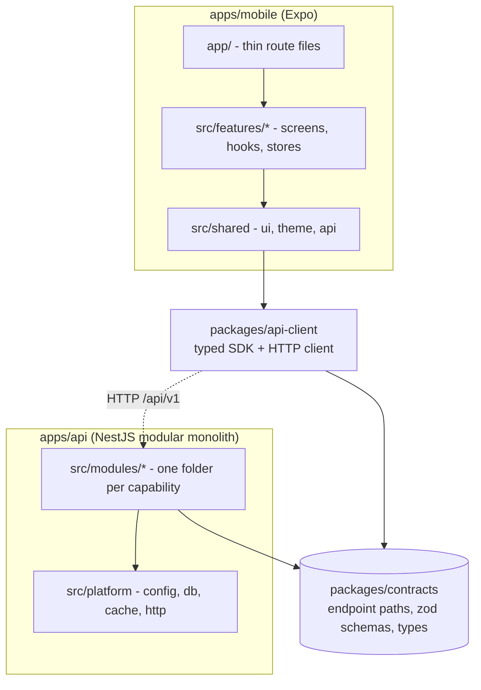
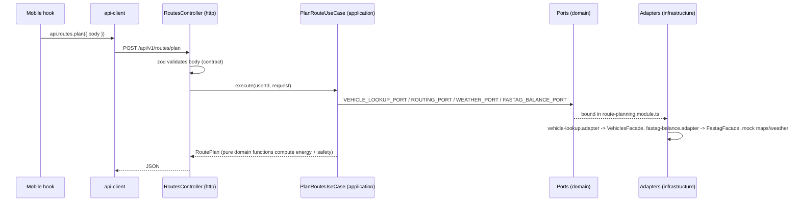

# Architecture

Know Your Route is a pnpm + Turborepo monorepo with one backend (`apps/api`), one mobile app (`apps/mobile`) and
a few packages. This page explains **who may talk to whom** and **how a call travels**. Two generated pages show
the live truth and are checked in CI:

- [`generated/module-map.md`](./generated/module-map.md): dependency graph of modules, features and packages.
- [`generated/api-map.md`](./generated/api-map.md): every endpoint -> backend handler -> mobile call sites.

## 1. The big picture



Rules of thumb:

1. **Contracts are the only thing the two apps share.** Paths, request/response types and zod schemas live in
   `packages/contracts`. The server decorates controllers with them, the SDK builds calls from them.
2. **Modules and features talk only through a public `index.ts`.** Deep imports into another module are rejected by
   `pnpm arch:check`.
3. **Business logic never imports a vendor or another module directly.** It talks to a *port* (an interface) and an
   *adapter* in `infrastructure/` implements it.

## 2. Backend (`apps/api/src`)

```
main.ts                      boot (prefix /api/v1, swagger, helmet, pino, shutdown hooks)
app.module.ts                composition root: lists the modules, nothing else
platform/                    technical plumbing shared by all modules (no business rules)
  config/     env validation (Zod schema), persistence driver, select-by-config
  database/   PrismaService (singleton, ping(), lifecycle hooks)
  cache/      CacheService (Redis via REDIS_URL, in-memory fallback in dev)
  logging/    nestjs-pino with structured JSON, redaction, request-id correlation
  errors/     AppError hierarchy (9 classes), standardized error envelope
  health/     /health (liveness) + /health/ready (Postgres + Redis readiness)
  storage/    StorageProvider port, S3StorageProvider (S3/MinIO), StorageService policy
  http/       HttpExceptionFilter, ZodValidationPipe, ContractBody/ContractQuery
  persistence/ repository provider factory (memory / prisma swap)
  demo/       seed data for PERSISTENCE_DRIVER=memory
modules/
  identity/        users, auth (JWT), preferences      -> exports IdentityModule, @CurrentUser, @Public
  vehicles/        vehicle profiles, telemetry         -> exports VehiclesModule, VehiclesFacade
  fastag/          FASTag status and toll sufficiency  -> exports FastagModule, FastagFacade
  route-planning/  routes, energy, safety, weather     -> exports RoutePlanningModule
  trips/           trips and AI explanations           -> exports TripsModule
```

Inside every module the layers always have the same names:

| Folder | Purpose | May import |
| --- | --- | --- |
| `http/` | Controllers. Validate input with the contract's zod schema, call one application service. | `application/`, `domain/`, contracts, `platform/http` |
| `application/` | Use cases / services. Orchestrate the work. | `domain/`, contracts |
| `domain/` | Pure rules (`energy.ts`, `safety.ts`, ...) and **ports** (interfaces + injection tokens). | contracts only |
| `infrastructure/` | Adapters: in-memory/Prisma repositories, mock providers, and the **only** place that talks to another module. | `domain/`, other modules' public API, `platform/` |
| `*.module.ts` | Nest wiring: binds each port to an adapter. | everything in its own module |

### How one request flows

`POST /routes/plan`:



### Swapping an implementation

Implementations are chosen **once at boot** by an explicit environment variable. Unknown values fail fast instead of
silently falling back.

| Variable | Values | Default |
| --- | --- | --- |
| `PERSISTENCE_DRIVER` | `memory`, `prisma` | `prisma` |
| `MAP_PROVIDER`, `WEATHER_PROVIDER`, `VEHICLE_PROVIDER`, `FASTAG_PROVIDER`, `AI_PROVIDER` | `mock` | `mock` |

To add a real provider: implement the port from the module's `domain/` in `infrastructure/`, register it in the
`selectByConfig(...)` map inside that module's `*.module.ts`. Nothing else changes.

## 3. Mobile (`apps/mobile`)

```
app/                 Expo Router files. One line each: export { XScreen as default } from '@/features/x'
src/
  features/<name>/   index.ts (public API) + screens/ components/ hooks/ store/
  shared/            ui, theme, config, api (the SDK instance), map  - no feature knowledge
  app-shell/         wiring that needs several features (e.g. API auth token <-> auth store)
```

- A feature imports another feature **only** via `@/features/<other>` (its `index.ts`).
- `shared/` never imports a feature. Features never import `app/` or `app-shell/`.
- **Only `shared/api` talks to the backend**; features use `api.<contract>.<endpoint>(...)` from `@/shared/api`.
- Feature direction: `auth` is the base; `vehicles`, `trips` use it; `route-planning` uses `vehicles` and `trips`;
  `home`/`onboarding`/`profile` compose the others. See the generated map for the current graph.

## 4. Packages

| Package | Role | Depends on |
| --- | --- | --- |
| `contracts` | Types, zod schemas, endpoint definitions. Built to `dist/` for Node, consumed as source by Metro/IDE. | zod |
| `api-client` | HTTP client + typed SDK (`createApiClient`). | contracts |
| `ui` | Design tokens. | nothing |
| `config` | Shared TS / lint config. | nothing |

## 5. Guardrails

`pnpm arch:check` (also run in CI) does two things:

1. **`arch:rules`**: dependency-cruiser enforces the rules in [`.dependency-cruiser.cjs`](../../.dependency-cruiser.cjs):
   no cycles, public-API-only imports between modules and features, pure `domain/`, no `http -> infrastructure`,
   mobile reaches the backend only via `shared/api`, contracts depend on nothing internal, and so on. Every rule has a
   comment saying why it exists.
2. **Generated maps**: regenerates the two files in `docs/architecture/generated/` and fails if a contract endpoint has
   no backend handler. CI then fails if the committed maps differ from the regenerated ones, so docs cannot go stale.

Run `pnpm arch:docs` after changing structure or endpoints and commit the result.

## 6. Recipes

**Add an endpoint**
1. Add it to the right `packages/contracts/src/<domain>/contract.ts` (+ schema/type).
2. Add a handler in the module's controller: `@Get(xContract.thing.path)`, validate with `@ContractBody/@ContractQuery`.
3. Call it from a mobile hook: `api.x.thing({ params, body, query })`. The compiler checks paths and types.
4. `pnpm arch:docs`.

**Add a backend module**: create `modules/<name>/{http,application,domain,infrastructure}`, an `index.ts` with the
public exports, a `<name>.module.ts`, and import it in `app.module.ts`. If it needs data from another module, declare
a port in your `domain/` and implement it in `infrastructure/` using the other module's public API.

**Add a mobile feature**: create `features/<name>/` with `index.ts`, add a one-line route file in `app/`.

## 7. Frozen baseline (read before generating code)

This section is the contract for humans and AI assistants. If a change needs to break it, change this page first.

### 7.1 Module boundaries

| Module | Owns | Public API (`index.ts`) | May depend on |
| --- | --- | --- | --- |
| `identity` | users, auth, preferences | `IdentityModule`, `@CurrentUser`, `@Public` | - |
| `vehicles` | vehicle profiles, telemetry | `VehiclesModule`, `VehiclesFacade` | `identity` (decorator only) |
| `fastag` | FASTag connection, toll sufficiency | `FastagModule`, `FastagFacade` | `identity` (decorator only) |
| `route-planning` | route discovery and route intelligence orchestration | `RoutePlanningModule` | `vehicles`, `fastag`, `identity` (decorator only) |
| `trips` | trips, AI explanations | `TripsModule` | `vehicles`, `identity` (decorator only) |

Direction is one way: `route-planning` never imports `trips`; `trips` never reaches into `route-planning`.
A module reaches another one only inside an `infrastructure/` adapter that implements a port of its own `domain/`.

### 7.2 Layer rules inside a module

| Layer | May import | Must not import |
| --- | --- | --- |
| `domain/` | own `domain/`, `packages/contracts`, zod | Nest, Prisma, vendors, other layers, other modules, `platform/` |
| `application/` | `domain/`, contracts, Nest decorators | `infrastructure/`, `http/`, `platform/`, other modules |
| `infrastructure/` | `domain/`, other modules' `index.ts`, `platform/` | `http/`, `application/` |
| `http/` | `application/`, `domain/`, contracts, `platform/http` | `infrastructure/` |

These are enforced by `.dependency-cruiser.cjs`. Domain code never mentions a provider name (no "Google", "Mapbox", ...);
provider names exist only in adapter file names and in `*_PROVIDER` config values.

### 7.3 Package rules

`contracts` depends on nothing internal -> `api-client` depends only on `contracts` -> `apps/mobile` uses `api-client`
only through `src/shared/api`. `apps/api` and `apps/mobile` never import each other.

### 7.4 `route-planning` tree

```
route-planning/
  http/            routes.controller.ts
  application/     plan-route.use-case.ts
  domain/
    ports/         routing | weather | vehicle-lookup | fastag-balance | plan-cache  (*.port.ts + index.ts)
    route/         default-vehicle.ts, plan-cache-key.ts
    energy/        energy.ts
    safety/        safety.ts
  infrastructure/
    routing/       mock-maps.adapter.ts            (MAP_PROVIDER)
    weather/       mock-weather.adapter.ts         (WEATHER_PROVIDER)
    vehicles/      vehicle-lookup.adapter.ts       -> VehiclesFacade
    fastag/        fastag-balance.adapter.ts       -> FastagFacade
    cache/         plan-cache.adapter.ts           -> platform cache
  route-planning.module.ts
  index.ts
```

Growth rules (do not create these folders ahead of code):

- A new capability (`traffic`, `toll` estimate, `stops`/`places`, `energy` providers) adds one `domain/ports/<x>.port.ts`,
  one `infrastructure/<x>/` adapter and a `selectByConfig` binding. Pure rules for it go in `domain/<x>/`.
- Split `PlanRouteUseCase` into `generate-routes` / `compare-routes` use cases only when it has two distinct reasons
  to change. Never grow a single service file to hold several capabilities.
- Port names describe the capability, not the vendor: `ROUTING_PORT`, `WEATHER_PORT`, `VEHICLE_LOOKUP_PORT`,
  `FASTAG_BALANCE_PORT`, `PLAN_CACHE_PORT`. A future toll cost estimate port is `TOLL_ESTIMATE_PORT` (not the FASTag balance).

### 7.5 Data flow

```
mobile -> api-client -> contracts -> HTTP -> route-planning (PlanRouteUseCase)
  -> ports: vehicles, fastag, routing, weather
  -> RouteProfile enriched with energy, safety, weather, fastag
  -> Route options -> mobile -> trips / AI explanation (trips module, separate request)
```

## 8. Phase 0 infrastructure baseline

The foundation layer established before feature development:

| Concern | Implementation | Location |
| --- | --- | --- |
| Config | Zod env schema, env-aware validation (dev/test/prod rules), fail-fast | `platform/config/env.ts` |
| Database | PostgreSQL via Prisma, committed migrations, `db:*` scripts | `platform/database/`, `prisma/` |
| Cache | Redis (ioredis via `REDIS_URL`), in-memory fallback in dev, prod fail-fast | `platform/cache/` |
| Logging | pino via nestjs-pino, structured JSON, request-id correlation, redaction | `platform/logging/` |
| Errors | 9 error classes, standard envelope `{ success: false, error: { code, message, requestId } }` | `platform/errors/` |
| Auth | JWT with issuer/audience, global guard, `@CurrentUser`, demo-login non-prod only | `modules/identity/` |
| HTTP | helmet, throttler, CORS allow-list, body limits, Swagger gating, graceful shutdown | `main.ts` |
| Health | `GET /health` (liveness), `GET /health/ready` (Postgres + Redis) | `platform/health/` |
| Storage | S3/MinIO provider, StorageService with key policy, type/size validation, signed URLs | `platform/storage/` |
| Mobile | api-client with request-id, error envelope parsing, GET retry, token persistence | `packages/api-client/`, `apps/mobile/` |
| Infra | `docker-compose.yml` (Postgres 16, Redis 7, Silo as S3 stand-in), `.nvmrc`, `infra:up`/`infra:down` | root |
| CI | GitHub Actions with Postgres/Redis services, migrations, typecheck, lint, test, build | `.github/workflows/ci.yml` |

### Frozen rule

> Mobile talks to API. API owns business logic. PostgreSQL owns persistent state. Redis owns transient/cache state.
> External providers are accessed only through backend adapters. Shared contracts remain the single source of truth.
