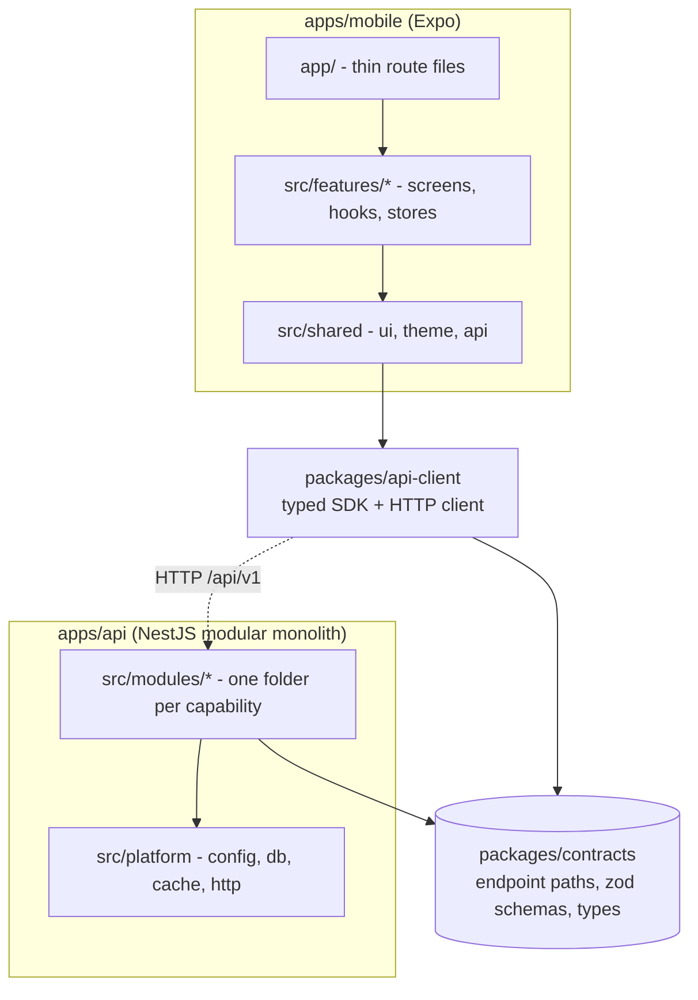
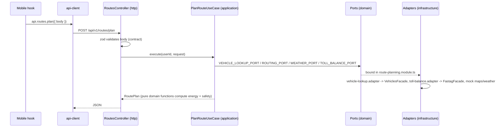

# Architecture

Know Your Route is a pnpm + Turborepo monorepo with one backend (`apps/api`), one mobile app (`apps/mobile`) and
a few packages. This page explains **who may talk to whom** and **how a call travels**. Two generated pages show
the live truth and are checked in CI:

- [`generated/module-map.md`](./generated/module-map.md): dependency graph of modules, features and packages.
- [`generated/api-map.md`](./generated/api-map.md): every endpoint -> backend handler -> mobile call sites.

## 1. The big picture



Rules of thumb:

1. **Contracts are the only thing the two apps share.** Paths, request/response types and zod schemas live in
   `packages/contracts`. The server decorates controllers with them, the SDK builds calls from them.
2. **Modules and features talk only through a public `index.ts`.** Deep imports into another module are rejected by
   `pnpm arch:check`.
3. **Business logic never imports a vendor or another module directly.** It talks to a *port* (an interface) and an
   *adapter* in `infrastructure/` implements it.

## 2. Backend (`apps/api/src`)

```
main.ts                      boot (prefix /api/v1, swagger, filters)
app.module.ts                composition root: lists the modules, nothing else
platform/                    technical plumbing shared by all modules (no business rules)
  config/  persistence/  database/  cache/  http/  demo/
modules/
  identity/        users, auth (JWT), preferences      -> exports IdentityModule, @CurrentUser, @Public
  vehicles/        vehicle profiles, telemetry         -> exports VehiclesModule, VehiclesFacade
  fastag/          FASTag status and toll sufficiency  -> exports FastagModule, FastagFacade
  route-planning/  routes, energy, safety, weather     -> exports RoutePlanningModule
  trips/           trips and AI explanations           -> exports TripsModule
```

Inside every module the layers always have the same names:

| Folder | Purpose | May import |
| --- | --- | --- |
| `http/` | Controllers. Validate input with the contract's zod schema, call one application service. | `application/`, `domain/`, contracts, `platform/http` |
| `application/` | Use cases / services. Orchestrate the work. | `domain/`, contracts |
| `domain/` | Pure rules (`energy.ts`, `safety.ts`, ...) and **ports** (interfaces + injection tokens). | contracts only |
| `infrastructure/` | Adapters: in-memory/Prisma repositories, mock providers, and the **only** place that talks to another module. | `domain/`, other modules' public API, `platform/` |
| `*.module.ts` | Nest wiring: binds each port to an adapter. | everything in its own module |

### How one request flows

`POST /routes/plan`:



### Swapping an implementation

Implementations are chosen **once at boot** by an explicit environment variable. Unknown values fail fast instead of
silently falling back.

| Variable | Values | Default |
| --- | --- | --- |
| `PERSISTENCE_DRIVER` | `memory`, `prisma` | `memory` |
| `MAP_PROVIDER`, `WEATHER_PROVIDER`, `VEHICLE_PROVIDER`, `FASTAG_PROVIDER`, `AI_PROVIDER` | `mock` | `mock` |

To add a real provider: implement the port from the module's `domain/` in `infrastructure/`, register it in the
`selectByConfig(...)` map inside that module's `*.module.ts`. Nothing else changes.

## 3. Mobile (`apps/mobile`)

```
app/                 Expo Router files. One line each: export { XScreen as default } from '@/features/x'
src/
  features/<name>/   index.ts (public API) + screens/ components/ hooks/ store/
  shared/            ui, theme, config, api (the SDK instance), map  - no feature knowledge
  app-shell/         wiring that needs several features (e.g. API auth token <-> auth store)
```

- A feature imports another feature **only** via `@/features/<other>` (its `index.ts`).
- `shared/` never imports a feature. Features never import `app/` or `app-shell/`.
- **Only `shared/api` talks to the backend**; features use `api.<contract>.<endpoint>(...)` from `@/shared/api`.
- Feature direction: `auth` is the base; `vehicles`, `trips` use it; `route-planning` uses `vehicles` and `trips`;
  `home`/`onboarding`/`profile` compose the others. See the generated map for the current graph.

## 4. Packages

| Package | Role | Depends on |
| --- | --- | --- |
| `contracts` | Types, zod schemas, endpoint definitions. Built to `dist/` for Node, consumed as source by Metro/IDE. | zod |
| `api-client` | HTTP client + typed SDK (`createApiClient`). | contracts |
| `ui` | Design tokens. | nothing |
| `config` | Shared TS / lint config. | nothing |

## 5. Guardrails

`pnpm arch:check` (also run in CI) does two things:

1. **`arch:rules`**: dependency-cruiser enforces the rules in [`.dependency-cruiser.cjs`](../../.dependency-cruiser.cjs):
   no cycles, public-API-only imports between modules and features, pure `domain/`, no `http -> infrastructure`,
   mobile reaches the backend only via `shared/api`, contracts depend on nothing internal, and so on. Every rule has a
   comment saying why it exists.
2. **Generated maps**: regenerates the two files in `docs/architecture/generated/` and fails if a contract endpoint has
   no backend handler. CI then fails if the committed maps differ from the regenerated ones, so docs cannot go stale.

Run `pnpm arch:docs` after changing structure or endpoints and commit the result.

## 6. Recipes

**Add an endpoint**
1. Add it to the right `packages/contracts/src/<domain>/contract.ts` (+ schema/type).
2. Add a handler in the module's controller: `@Get(xContract.thing.path)`, validate with `@ContractBody/@ContractQuery`.
3. Call it from a mobile hook: `api.x.thing({ params, body, query })`. The compiler checks paths and types.
4. `pnpm arch:docs`.

**Add a backend module**: create `modules/<name>/{http,application,domain,infrastructure}`, an `index.ts` with the
public exports, a `<name>.module.ts`, and import it in `app.module.ts`. If it needs data from another module, declare
a port in your `domain/` and implement it in `infrastructure/` using the other module's public API.

**Add a mobile feature**: create `features/<name>/` with `index.ts`, add a one-line route file in `app/`.
