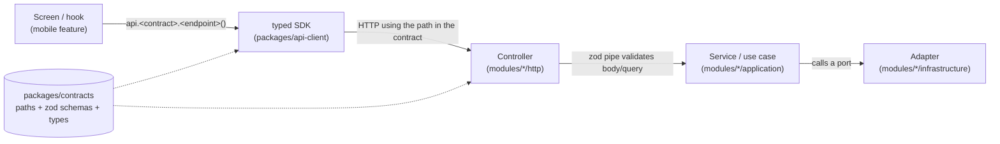

<!-- GENERATED by scripts/architecture/generate.mjs - do not edit. Run `pnpm arch:docs`. -->

# API call map

How every backend call flows, derived from the contracts, the controllers and the mobile call sites:

| HTTP | Contract entry | Backend handler (controller) | Called from (mobile) |
| --- | --- | --- | --- |
| `POST` `/auth/login` | `auth.login` | modules/identity/http/auth.controller.ts:17 `login` | `src/features/auth/hooks/useAuth.ts:12` |
| `POST` `/auth/signup` | `auth.signup` | modules/identity/http/auth.controller.ts:22 `signup` | `src/features/auth/hooks/useAuth.ts:29` |
| `POST` `/auth/demo-login` | `auth.demoLogin` | modules/identity/http/auth.controller.ts:27 `demoLogin` | _not used by mobile yet_ |
| `GET` `/users/me` | `users.me` | modules/identity/http/users.controller.ts:11 `getMe` | _not used by mobile yet_ |
| `PATCH` `/users/me/onboarded` | `users.markOnboarded` | modules/identity/http/users.controller.ts:16 `markOnboarded` | `src/features/onboarding/screens/PermissionsScreen.tsx:19` |
| `GET` `/users/me/preferences` | `users.getPreferences` | modules/identity/http/users.controller.ts:21 `getPreferences` | _not used by mobile yet_ |
| `PATCH` `/users/me/preferences` | `users.updatePreferences` | modules/identity/http/users.controller.ts:26 `updatePreferences` | _not used by mobile yet_ |
| `GET` `/vehicles` | `vehicles.list` | modules/vehicles/http/vehicles.controller.ts:17 `list` | `src/features/vehicles/hooks/useVehicles.ts:14` |
| `GET` `/vehicles/:id` | `vehicles.get` | modules/vehicles/http/vehicles.controller.ts:22 `get` | _not used by mobile yet_ |
| `POST` `/vehicles` | `vehicles.register` | modules/vehicles/http/vehicles.controller.ts:27 `register` | `src/features/vehicles/hooks/useVehicles.ts:28` |
| `POST` `/vehicles/:id/snapshot` | `vehicles.uploadSnapshot` | modules/vehicles/http/vehicles.controller.ts:35 `uploadSnapshot` | `src/features/vehicles/hooks/useVehicles.ts:42` `src/features/vehicles/screens/VehicleScreen.tsx:46` |
| `POST` `/vehicles/:id/sync-telemetry` | `vehicles.syncTelemetry` | modules/vehicles/http/vehicles.controller.ts:44 `syncTelemetry` | `src/features/vehicles/screens/VehicleScreen.tsx:29` |
| `POST` `/routes/plan` | `routes.plan` | modules/route-planning/http/routes.controller.ts:16 `plan` | `src/features/route-planning/hooks/useRoutePlanning.ts:10` |
| `GET` `/fastag/me/status` | `fastag.myStatus` | modules/fastag/http/fastag.controller.ts:17 `getMyStatus` | _not used by mobile yet_ |
| `GET` `/fastag/me/verify` | `fastag.myVerify` | modules/fastag/http/fastag.controller.ts:25 `verifyMySufficiency` | _not used by mobile yet_ |
| `GET` `/fastag/:tagNumber/status` | `fastag.tagStatus` | modules/fastag/http/fastag.controller.ts:33 `getTagStatus` | _not used by mobile yet_ |
| `GET` `/fastag/:tagNumber/verify` | `fastag.tagVerify` | modules/fastag/http/fastag.controller.ts:42 `verifyTagSufficiency` | _not used by mobile yet_ |
| `GET` `/trips` | `trips.list` | modules/trips/http/trips.controller.ts:17 `list` | `src/features/trips/hooks/useTrip.ts:12` |
| `POST` `/trips` | `trips.create` | modules/trips/http/trips.controller.ts:22 `create` | `src/features/trips/hooks/useTrip.ts:36` `src/features/trips/hooks/useTrip.ts:57` |
| `GET` `/trips/:id` | `trips.get` | modules/trips/http/trips.controller.ts:30 `get` | `src/features/trips/hooks/useTrip.ts:19` |
| `GET` `/trips/:id/explain` | `trips.explain` | modules/trips/http/trips.controller.ts:35 `explain` | `src/features/trips/hooks/useTrip.ts:27` |

Contracts live in `packages/contracts/src/*/contract.ts`. Changing a path, body or response there changes the
server decorators and the SDK call signature at the same time, and the compiler points at every caller.
