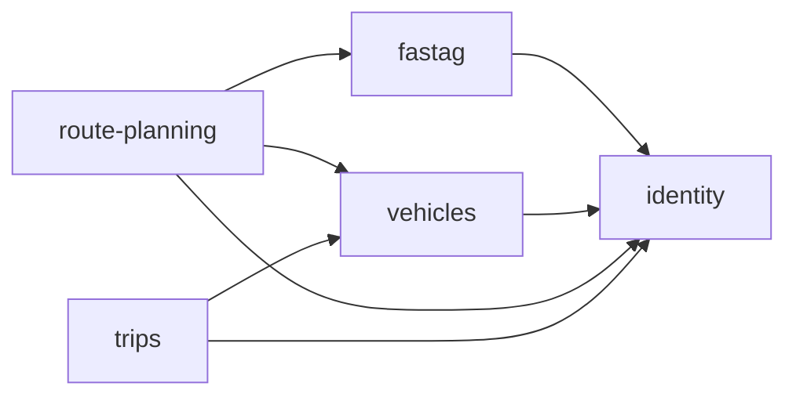
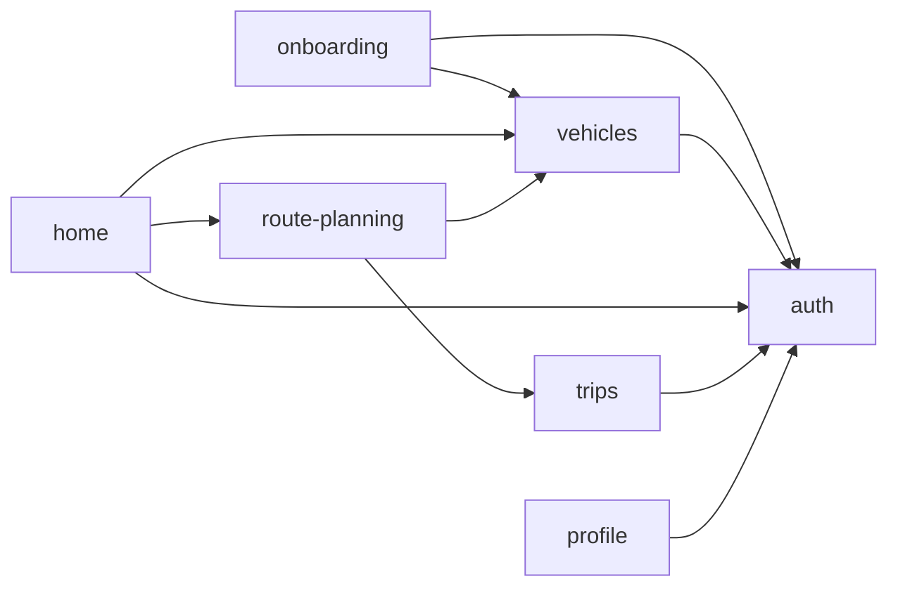
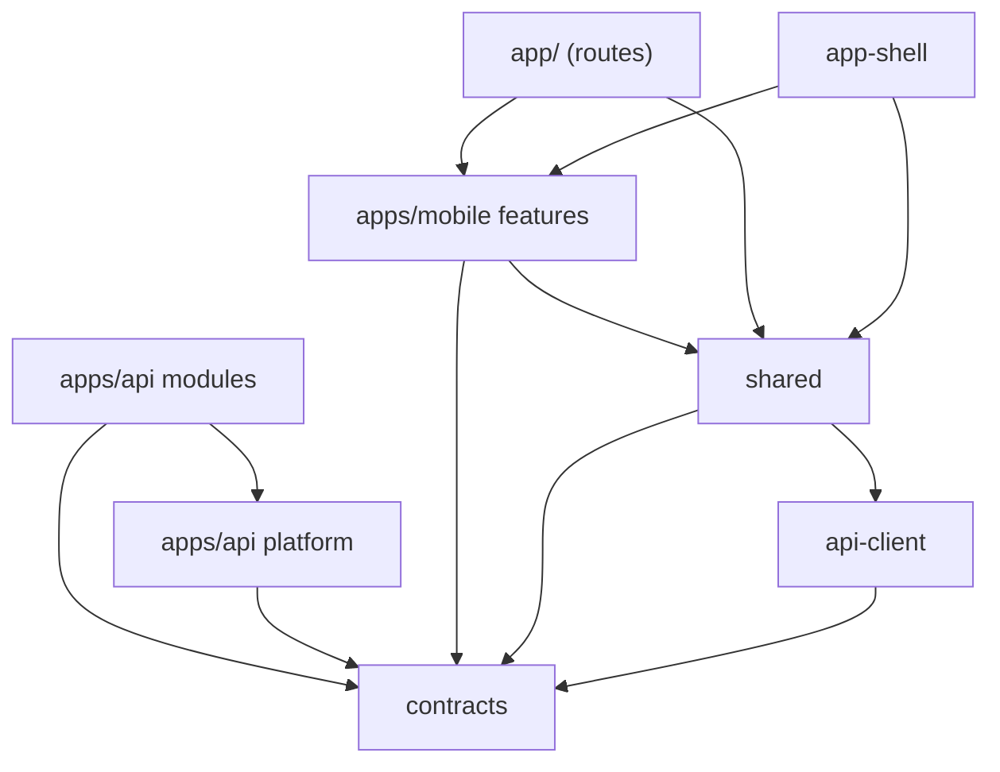

<!-- GENERATED by scripts/architecture/generate.mjs - do not edit. Run `pnpm arch:docs`. -->

# Module map

Generated from the real import graph (dependency-cruiser). The rules that keep this graph honest live in
`.dependency-cruiser.cjs` and run in CI via `pnpm arch:check`.

## Backend modules (apps/api)

An arrow means "module A imports module B's public API (`index.ts`)". Only `infrastructure/` adapters and the
`*.module.ts` files are allowed to create such an arrow; use cases only see ports from their own `domain/`.

Which file creates each arrow:

| From | Calls | Through (file that imports it) |
| --- | --- | --- |
| fastag | identity | `modules/fastag/http/fastag.controller.ts` |
| route-planning | fastag | `modules/route-planning/infrastructure/toll-balance.adapter.ts` `modules/route-planning/route-planning.module.ts` |
| route-planning | identity | `modules/route-planning/http/routes.controller.ts` |
| route-planning | vehicles | `modules/route-planning/infrastructure/vehicle-lookup.adapter.ts` `modules/route-planning/route-planning.module.ts` |
| trips | identity | `modules/trips/http/trips.controller.ts` |
| trips | vehicles | `modules/trips/infrastructure/vehicle-lookup.adapter.ts` `modules/trips/trips.module.ts` |
| vehicles | identity | `modules/vehicles/http/vehicles.controller.ts` |

### Backend modules -> platform (shared technical plumbing)

| From | Calls | Through (file that imports it) |
| --- | --- | --- |
| fastag | platform | `modules/fastag/fastag.module.ts` `modules/fastag/http/fastag.controller.ts` `modules/fastag/infrastructure/in-memory-fastag-connection.repository.ts` `modules/fastag/infrastructure/prisma-fastag-connection.repository.ts` |
| identity | platform | `modules/identity/application/auth.service.ts` `modules/identity/http/auth.controller.ts` `modules/identity/http/users.controller.ts` `modules/identity/identity.module.ts` `modules/identity/infrastructure/in-memory-user.repository.ts` `modules/identity/infrastructure/prisma-user.repository.ts` |
| route-planning | platform | `modules/route-planning/http/routes.controller.ts` `modules/route-planning/infrastructure/plan-cache.adapter.ts` `modules/route-planning/route-planning.module.ts` |
| trips | platform | `modules/trips/http/trips.controller.ts` `modules/trips/trips.module.ts` |
| vehicles | platform | `modules/vehicles/http/vehicles.controller.ts` `modules/vehicles/infrastructure/in-memory-vehicle.repository.ts` `modules/vehicles/infrastructure/prisma-vehicle.repository.ts` `modules/vehicles/vehicles.module.ts` |

## Mobile features (apps/mobile)

An arrow means "feature A imports feature B's public API (`index.ts`)".

| From | Calls | Through (file that imports it) |
| --- | --- | --- |
| home | auth | `features/home/screens/HomeScreen.tsx` |
| home | route-planning | `features/home/screens/HomeScreen.tsx` |
| home | vehicles | `features/home/screens/HomeScreen.tsx` |
| onboarding | auth | `features/onboarding/screens/PermissionsScreen.tsx` |
| onboarding | vehicles | `features/onboarding/screens/VehicleSetupScreen.tsx` |
| profile | auth | `features/profile/screens/ProfileScreen.tsx` |
| route-planning | trips | `features/route-planning/screens/RouteDetailScreen.tsx` |
| route-planning | vehicles | `features/route-planning/screens/PlanScreen.tsx` `features/route-planning/screens/RouteDetailScreen.tsx` |
| trips | auth | `features/trips/hooks/useTrip.ts` |
| vehicles | auth | `features/vehicles/hooks/useVehicles.ts` |

## Across the monorepo

Feature/module internals collapsed; this is the "who talks to whom between apps and packages" view.

