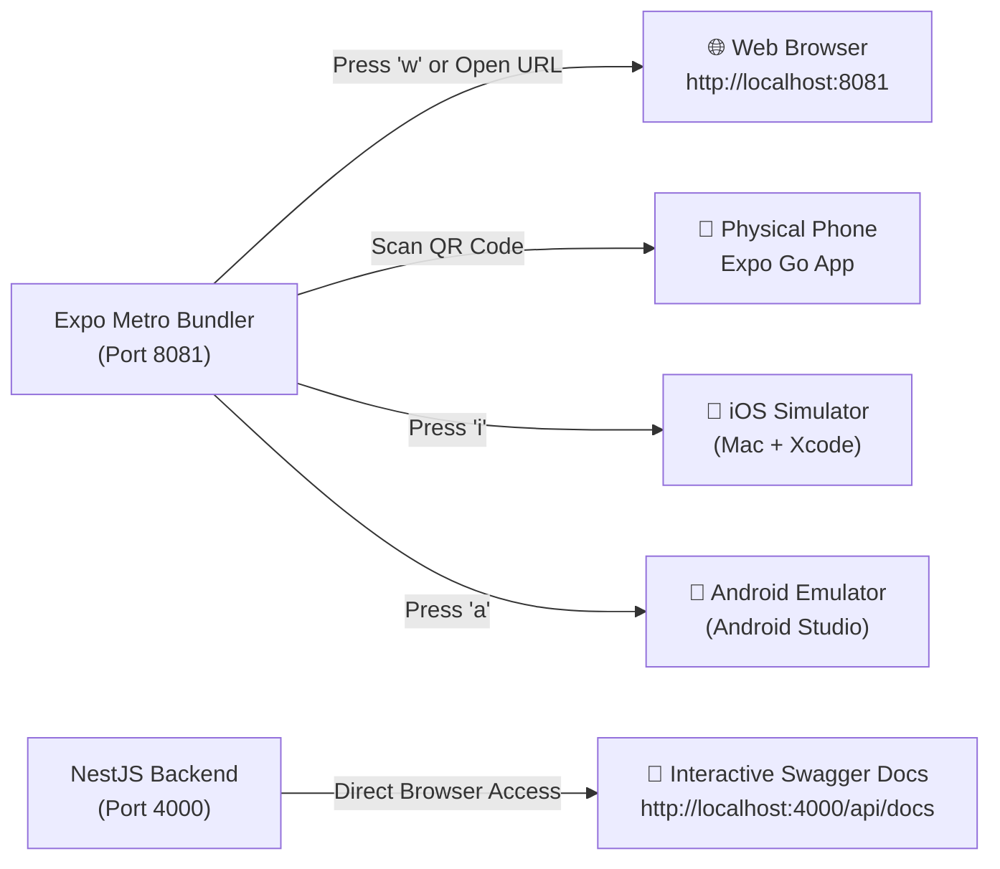

# 🚀 01 — Getting Started & Beginner's Setup Guide

> **Target Audience:** Complete beginners, new team members, or anyone who has never run a Turborepo monorepo, NestJS backend, or React Native / Expo app before.

This guide walks you through every single step required to install, configure, run, and test the **Know Your Route** platform on your machine.

---

## 📋 Table of Contents
1. [Prerequisites: What You Need to Install](#1-prerequisites-what-you-need-to-install)
2. [Step 1: Clone and Open Project](#step-1-clone-and-open-project)
3. [Step 2: Install Dependencies](#step-2-install-dependencies)
4. [Step 3: Environment Variables Setup](#step-3-environment-variables-setup)
5. [Step 4: Starting the Applications](#step-4-starting-the-applications)
6. [Step 5: How to View & Test the Apps](#step-5-how-to-view--test-the-apps)
   - [A. Web Browser (Easiest & Fastest)](#a-web-browser-easiest--fastest)
   - [B. Physical Phone via Expo Go App](#b-physical-phone-via-expo-go-app)
   - [C. iOS Simulator (Mac only)](#c-ios-simulator-mac-only)
   - [D. Android Emulator](#d-android-emulator)
   - [E. Testing the Backend via Swagger API Docs](#e-testing-the-backend-via-swagger-api-docs)
7. [Zero-Friction Local Dev Mode (No API Keys Needed!)](#zero-friction-local-dev-mode-no-api-keys-needed)
8. [Troubleshooting & Common FAQs](#troubleshooting--common-faqs)

---

## 1. Prerequisites: What You Need to Install

Before touching any code, make sure the following free software tools are installed on your computer:

### 1.1 Node.js (Version 20 or higher)
Node.js is the runtime environment that executes JavaScript/TypeScript on your computer.
- **How to check:** Open your terminal (macOS Terminal, Linux Bash, or Windows PowerShell) and run:
  ```bash
  node -v
  ```
  *It should say `v20.x.x` or higher (e.g., `v22.12.0`).*
- **If not installed:** Download and install the LTS version from [nodejs.org](https://nodejs.org).

### 1.2 pnpm (Fast Package Manager)
This repository uses **pnpm workspaces** instead of `npm` or `yarn` because pnpm is much faster and saves disk space.
- **How to check:**
  ```bash
  pnpm -v
  ```
- **If not installed:** Run this command in your terminal:
  ```bash
  npm install -g pnpm
  ```
  *(Requires version `9.x` or `10.x`)*

### 1.3 Git
Used for cloning and managing code changes.
- **How to check:**
  ```bash
  git --version
  ```

### 1.4 Code Editor (Recommended: VS Code or Antigravity IDE)
- Download [Visual Studio Code](https://code.visualstudio.com/) if you don't already have an IDE.

---

## Step 1: Clone and Open Project

Open your terminal and navigate to the project directory:

```bash
# If cloning from GitHub:
git clone https://github.com/your-username/know-your-route.git
cd know-your-route

# If already in the directory:
cd /Users/ravichandola/Documents/Know_Your_Route
```

Verify your files:
```bash
ls -la
```
You should see `package.json`, `pnpm-workspace.yaml`, `turbo.json`, `apps/`, and `packages/`.

---

## Step 2: Install Dependencies

Run this single command at the **root** of the project:

```bash
pnpm install
```

### What does this command do?
1. It downloads all necessary libraries for the mobile app, backend API, and shared packages.
2. It links internal workspace packages (`@know-your-route/types`, `@know-your-route/validation`, `@know-your-route/api-client`, `@know-your-route/ui`) so they can reference each other without needing to be published to npm.

---

## Step 3: Environment Variables Setup

The project includes pre-configured environment files so you can run it right away without typing any API keys.

Let's check the `.env.development` file at the root of the project:

```bash
# Verify .env.development exists
cat .env.development
```

### Breakdown of the settings:

| Variable | Default Value | Explanation |
| :--- | :--- | :--- |
| `PORT` | `4000` | Port where the NestJS Backend API will listen. |
| `EXPO_PUBLIC_API_URL` | `http://localhost:4000/api/v1` | URL the mobile app uses to communicate with the backend. |
| `MAP_PROVIDER` | `mock` | Uses built-in realistic mock data for routes, roads, and traffic. |
| `WEATHER_PROVIDER` | `mock` | Provides mock rain, clouds, temperature, and road condition reports. |
| `TOLL_PROVIDER` | `mock` | Provides mock toll gate locations and toll charges in INR. |
| `FASTAG_PROVIDER` | `mock` | Provides mock FASTag balance and simulated vehicle tags. |
| `AI_PROVIDER` | `mock` | Generates intelligent route rationale summaries using local algorithms. |

> 💡 **Tip:** If `.env.development` is missing for any reason, simply copy `.env.example`:
> ```bash
> cp .env.example .env.development
> ```

---

## Step 4: Starting the Applications

You have two convenient ways to start the project:

### Method A: Start Everything Concurrently (Recommended)
Open one terminal window and run:
```bash
pnpm dev
```
Turborepo will automatically launch:
1. The **Backend API** at `http://localhost:4000`
2. The **Mobile Expo Bundler** at `http://localhost:8081`

---

### Method B: Start in Separate Terminals (Best for clean logs)

#### Terminal 1 — Start the Backend API:
```bash
pnpm dev:api
```
When successful, you will see output like:
```text
[KnowYourRouteAPI] 🚀 Know Your Route API running on: http://localhost:4000/api/v1
[KnowYourRouteAPI] 📑 Swagger Documentation available at: http://localhost:4000/api/docs
```

#### Terminal 2 — Start the Mobile App (Expo):
```bash
pnpm dev:mobile
```
When successful, you will see a large **QR Code** and shortcuts:
```text
› Metro waiting on exp://192.168.1.3:8081
› Scan the QR code above with Expo Go (Android) or the Camera app (iOS)
› Web is waiting on http://localhost:8081

› Press a │ open Android
› Press i │ open iOS simulator
› Press w │ open web
› Press r │ reload app
```

---

## Step 5: How to View & Test the Apps

Here are the different ways you can interact with the app:



### A. Web Browser (Easiest & Fastest)
You don't need any phone or simulator to test the mobile app!
1. In the terminal running `pnpm dev:mobile`, press the key **`w`** on your keyboard.
2. Alternatively, open your browser (Chrome, Safari, Brave) and visit:  
   👉 **`http://localhost:8081`**
3. You will see the **Know Your Route** mobile interface rendered directly in your browser.
4. Click **"One-Tap Demo Sign In"** to instantly test the flow without entering a password.

---

### B. Physical Phone via Expo Go App
You can test the actual mobile app on your real iPhone or Android device:

1. **Install Expo Go:**
   - **Android:** Open Google Play Store and install **Expo Go**.
   - **iOS:** Open App Store and install **Expo Go**.
2. **Make sure your computer and your phone are connected to the SAME Wi-Fi network.**
3. **Open the App:**
   - **Android:** Open Expo Go and tap **"Scan QR Code"**. Scan the QR code shown in your terminal.
   - **iOS:** Open the native **Camera app** and point it at the QR code in your terminal. Tap the yellow Expo banner that appears.
4. **Important note for Phone Testing:**  
   Your phone cannot reach `http://localhost:4000`. To let your phone communicate with the backend, update `EXPO_PUBLIC_API_URL` in `.env.development` with your computer's local Wi-Fi IP address (e.g., `http://192.168.1.3:4000/api/v1`). Find your local IP on Mac with:
   ```bash
   ipconfig getifaddr en0
   ```

---

### C. iOS Simulator (Mac only)
If you have a Mac and Xcode installed:
1. In the terminal running Expo, press **`i`**.
2. Expo will automatically boot the iOS Simulator and launch the app.

---

### D. Android Emulator
If you have Android Studio installed with a Virtual Device (AVD):
1. Start your Android Emulator from Android Studio.
2. In the terminal running Expo, press **`a`**.
3. Expo will push the app onto your emulator.

---

### E. Testing the Backend via Swagger API Docs
The backend includes an interactive web interface where you can view every API endpoint and test requests right from your browser:

1. Ensure the API is running (`pnpm dev:api`).
2. Open your browser and navigate to:  
   👉 **`http://localhost:4000/api/docs`**
3. You can click on any endpoint (such as `POST /api/v1/routes/plan` or `GET /api/v1/vehicles`), click **"Try it out"**, and press **"Execute"** to see live JSON responses!

---

## Zero-Friction Local Dev Mode (No API Keys Needed!)

One of the best design choices in Know Your Route is that **you do not need to install PostgreSQL, Redis, or pay for Google Maps API keys to get started**.

1. **In-Memory Cache Fallback:** If Redis is not running on your computer, the backend automatically catches the connection failure and switches to a built-in in-memory cache with zero errors.
2. **Graceful Database Fallback:** If PostgreSQL is not running, the backend falls back to built-in mock repositories so that all endpoints return realistic mock data.
3. **Mock Providers:** Maps, weather, tolls, vehicle telemetry, and AI summaries are all generated by smart mock adapters when `MAP_PROVIDER=mock`, `WEATHER_PROVIDER=mock`, etc. are set.

When you're ready to connect real databases and external APIs later, see [**06-PROVIDERS-AND-INTELLIGENCE.md**](./06-PROVIDERS-AND-INTELLIGENCE.md).

---

## Troubleshooting & Common FAQs

### Q1: `Error: listen EADDRINUSE: address already in use :::8081` (or port 4000)
**Cause:** Another process (like an older Metro or Node process) is already using the port.  
**Fix:**
```bash
# Find and kill the process using port 8081
lsof -ti :8081 | xargs kill -9

# Find and kill the process using port 4000
lsof -ti :4000 | xargs kill -9
```
Then rerun `pnpm dev`.

---

### Q2: Metro bundler warning: `react-native@0.76.6 - expected version: 0.76.9`
**Cause:** Minor patch version difference in React Native.  
**Fix:** This is just an informational warning and will **not** prevent the app from compiling or running. You can safely ignore it, or update with:
```bash
cd apps/mobile && npx expo install --fix
```

---

### Q3: Mobile app shows "Network Request Failed"
**Cause:** 
- If running on **Web (`http://localhost:8081`)**: Ensure the backend is running (`http://localhost:4000/api/v1`).
- If running on a **Physical Phone**: The phone cannot connect to `localhost`. Change `EXPO_PUBLIC_API_URL` in `.env.development` from `http://localhost:4000/api/v1` to your computer's LAN IP (e.g., `http://192.168.1.3:4000/api/v1`) and restart Expo with `pnpm dev:mobile --clear`.

---

### Q4: How do I clear the Metro / Expo cache?
If code changes are not reflecting or you encounter bundler glitches:
```bash
cd apps/mobile
npx expo start -c
```
*(The `-c` flag clears Metro cache)*.

---

### Q5: How do I run a clean build from scratch?
If dependencies ever get into an inconsistent state:
```bash
pnpm clean
pnpm install
pnpm dev
```

---

👉 **Next Step:** To understand how the entire system works under the hood, read [**02-SYSTEM-ARCHITECTURE.md**](./02-SYSTEM-ARCHITECTURE.md).
