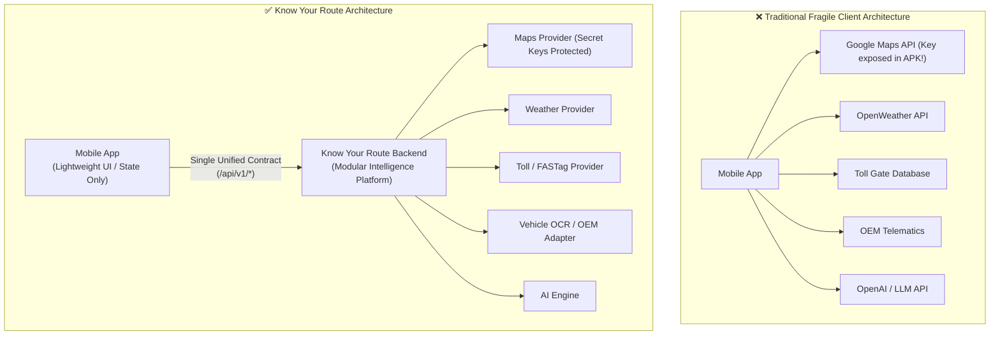
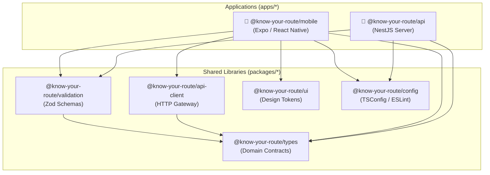
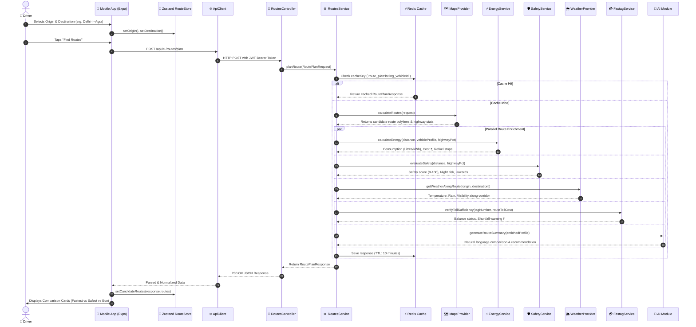
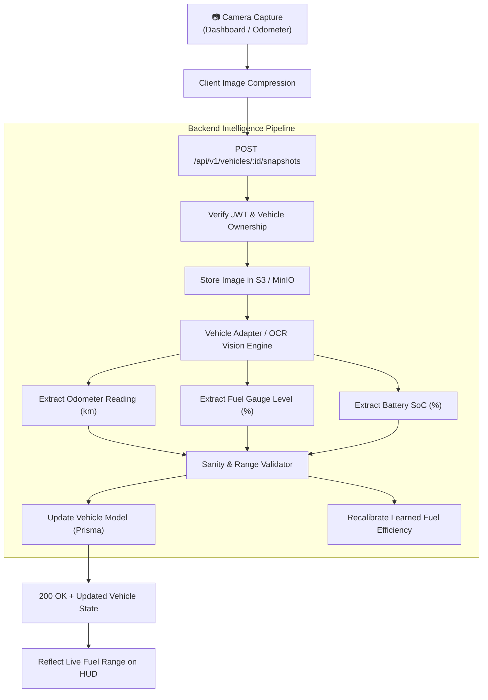
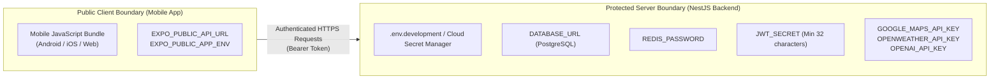

# 🏛️ 02 — System Architecture & Data Flow

> **Scope:** High-level system design, monorepo structure, client-server segregation philosophy, and complete end-to-end request/response lifecycles.

---

## 📋 Table of Contents
1. [Core Architectural Philosophy](#1-core-architectural-philosophy)
2. [Monorepo Workspace Topology](#2-monorepo-workspace-topology)
3. [Package Dependency Graph](#3-package-dependency-graph)
4. [End-to-End Route Intelligence Lifecycle](#4-end-to-end-route-intelligence-lifecycle)
5. [Vehicle Snapshot & OCR Architecture](#5-vehicle-snapshot--ocr-architecture)
6. [Security & Secret Containment](#6-security--secret-containment)
7. [Caching & Performance Strategy](#7-caching--performance-strategy)

---

## 1. Core Architectural Philosophy

### 🛡️ "Client Application over Backend Intelligence Platform"
A fundamental design rule of **Know Your Route** is that **the mobile client NEVER connects directly to third-party APIs**.



### Why this is critical:
1. **Zero Secret Leakage:** Google Maps, OpenWeather, and OpenAI API keys are kept safely on the backend server. Reverse-engineering the mobile APK/IPA will reveal zero third-party credentials.
2. **Unified Data Normalization:** Instead of the mobile app dealing with 5 different JSON payload formats from 5 external vendors, the backend normalizes everything into clean, standardized TypeScript contracts defined in `@know-your-route/types`.
3. **Heavy Computation Offloaded:** Complex calculations—such as vehicle drag coefficients, multi-segment highway safety scores, and FASTag toll matching—are performed on the server, saving the user's phone battery and CPU.
4. **Instant Provider Swapping:** If you switch from Google Maps to Mapbox, or from OpenAI to Google Gemini, **zero mobile app updates or store releases are needed**. You simply toggle the backend adapter.

---

## 2. Monorepo Workspace Topology

The repository is organized as a high-performance monorepo using **Turborepo** and **pnpm workspaces**:

```text
know-your-route/
├── apps/
│   ├── mobile/         # React Native + Expo + Expo Router + Zustand + TanStack Query
│   └── api/            # NestJS Modular Monolith + Prisma + Redis + Providers
├── packages/
│   ├── types/          # Canonical Domain Contracts (Single Source of Truth)
│   ├── validation/     # Shared Zod Schemas (Runtime validation for both apps)
│   ├── api-client/     # Resilient HTTP Client with Token Injection & Error Normalization
│   ├── config/         # Shared TypeScript & ESLint configurations
│   └── ui/             # Design Tokens & Theme system (Colors, Spacing, Typography)
├── turbo.json          # Turborepo task pipeline configuration
├── pnpm-workspace.yaml # Monorepo workspace mapping
└── package.json        # Root scripts & devDependencies
```

### Workspace Directory Responsibilities:

| Directory | Type | Responsibility |
| :--- | :--- | :--- |
| `apps/mobile` | Application | Cross-platform mobile app targeting Android, iOS, and Web. Handles UI rendering, user interaction, device location, and Zustand store updates. |
| `apps/api` | Application | NestJS REST API server exposing `/api/v1`. Houses business logic, route computation, telemetry processing, database access, and provider adapters. |
| `packages/types` | Library | Canonical TypeScript types (`VehicleProfile`, `RouteProfile`, `EnergyContext`, `SafetyContext`, etc.). Guarantees type safety between frontend and backend. |
| `packages/validation` | Library | Zod schemas for incoming API payloads and forms. Validates data identically on both client (before sending) and server (upon receiving). |
| `packages/api-client` | Library | Custom `BaseApiClient` class wrapping `fetch`. Handles automatic JWT bearer token injection, network retries, timeouts, and error normalization. |
| `packages/ui` | Library | Visual design tokens: brand color palettes (slate, emerald, cyan, warning, danger), traffic condition colors, fuel categories, typography scales, spacing, and shadows. |
| `packages/config` | Library | Shared build rules: `tsconfig.base.json` and linter presets inherited by all apps and packages. |

---

## 3. Package Dependency Graph



---

## 4. End-to-End Route Intelligence Lifecycle

Here is the step-by-step sequence that occurs when a user enters an origin and destination and taps **"Find Intelligent Routes"**:



---

## 5. Vehicle Snapshot & OCR Architecture

Drivers can register vehicles or update odometer/fuel readings simply by photographing their car dashboard:



---

## 6. Security & Secret Containment



### Key Security Guardrails:
1. **No Third-Party Keys in Mobile:** Only `EXPO_PUBLIC_*` variables are exposed to the mobile app bundle. Secrets like `GOOGLE_MAPS_API_KEY` are only ever read inside `apps/api`.
2. **Stateless JWT Tokens:** Authentication uses industry-standard JSON Web Tokens with configurable expiration (`7d`).
3. **Prisma ORM Protection:** SQL injection is completely prevented through parameterized queries generated automatically by Prisma.
4. **Input Sanitization:** Every request passing through NestJS is validated against shared Zod schemas and NestJS `ValidationPipe({ whitelist: true })` which strips unexpected payload properties.

---

## 7. Caching & Performance Strategy

To ensure lightning-fast response times (<100ms) and avoid excessive third-party API billing:

| Layer | Technology | TTL (Time-To-Live) | Cache Key Pattern |
| :--- | :--- | :--- | :--- |
| **Route Searches** | Redis / In-Memory | 10 Minutes | `route_plan:{originLat,lng}_{destLat,lng}_{vehicleId}` |
| **Corridor Weather** | Redis / In-Memory | 30 Minutes | `weather:{lat,lng}_{hour}` |
| **FASTag Balance** | Redis / In-Memory | 5 Minutes | `fastag:{tagNumber}` |
| **Client Navigation** | Zustand Store | App Session | In-memory client state for instant tab transitions |

---

👉 **Next Step:** To explore the inner workings of the backend server, read [**03-BACKEND-API-LAYER.md**](./03-BACKEND-API-LAYER.md).
