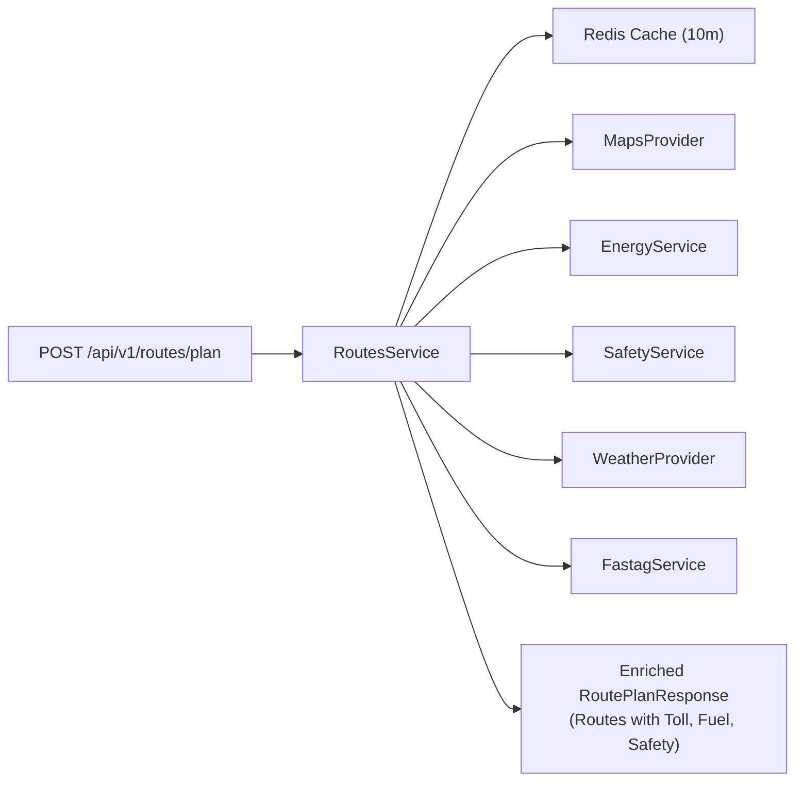
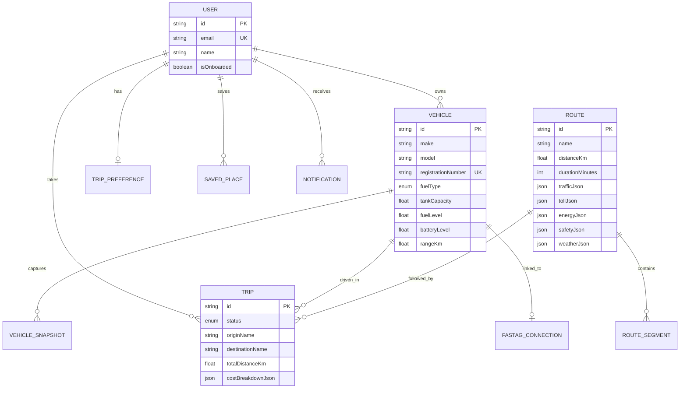

# ⚙️ 03 — Backend API Layer (NestJS)

> **Scope:** Detailed engineering guide for `apps/api` — NestJS modular monolith, module responsibilities, Prisma database models, Redis caching, error filters, and Swagger documentation.

---

## 📋 Table of Contents
1. [Backend Overview & Tech Stack](#1-backend-overview--tech-stack)
2. [Entry Point & Server Bootstrap (`main.ts`)](#2-entry-point--server-bootstrap-maints)
3. [Modular Monolith Architecture](#3-modular-monolith-architecture)
4. [Module Breakdown & Responsibilities](#4-module-breakdown--responsibilities)
   - [AuthModule](#authmodule)
   - [UsersModule](#usersmodule)
   - [VehiclesModule](#vehiclesmodule)
   - [RoutesModule](#routesmodule)
   - [TripsModule](#tripsmodule)
   - [EnergyModule](#energymodule)
   - [SafetyModule](#safetymodule)
   - [FastagModule](#fastagmodule)
   - [AIModule](#aimodule)
   - [ProvidersModule](#providersmodule)
5. [Database Layer: Prisma ORM & Schema Models](#5-database-layer-prisma-orm--schema-models)
6. [Resilient In-Memory & Redis Caching](#6-resilient-in-memory--redis-caching)
7. [Global Interceptors, Filters & Validation](#7-global-interceptors-filters--validation)
8. [Interactive Swagger API Documentation](#8-interactive-swagger-api-documentation)

---

## 1. Backend Overview & Tech Stack

The backend is built as a **Modular Monolith** using **NestJS**, a progressive TypeScript framework that enforces clean separation of concerns, dependency injection, and enterprise-grade scalability.

### Technologies:
- **Framework:** NestJS v10 (`@nestjs/common`, `@nestjs/core`, `@nestjs/swagger`)
- **Language:** TypeScript 5.7
- **Database ORM:** Prisma ORM with PostgreSQL
- **Caching:** Redis (`ioredis`) with built-in in-memory fallback
- **Authentication:** Passport JWT (`@nestjs/jwt`, `@nestjs/passport`, `bcryptjs`)
- **Validation:** `class-validator`, `class-transformer`, and `@know-your-route/validation` (Zod)

---

## 2. Entry Point & Server Bootstrap (`main.ts`)

The server starts from [`apps/api/src/main.ts`](file:///Users/ravichandola/Documents/Know_Your_Route/apps/api/src/main.ts):

```typescript
// Key configuration in main.ts
const app = await NestFactory.create(AppModule);

// 1. Cross-Origin Resource Sharing (CORS) for Mobile & Web clients
app.enableCors({ origin: '*', credentials: true });

// 2. Global API Prefix: /api/v1
app.setGlobalPrefix('api/v1');

// 3. Automatic DTO Validation & Property Sanitization
app.useGlobalPipes(new ValidationPipe({ whitelist: true, transform: true }));

// 4. Global Logging & Exception Handling
app.useGlobalFilters(new HttpExceptionFilter());
app.useGlobalInterceptors(new LoggingInterceptor());

// 5. OpenAPI Swagger Documentation at /api/docs
const config = new DocumentBuilder()
  .setTitle('Know Your Route API')
  .setVersion('1.0')
  .addBearerAuth()
  .build();
SwaggerModule.setup('api/docs', app, SwaggerModule.createDocument(app, config));
```

---

## 3. Modular Monolith Architecture

The backend code is organized into isolated, cohesive domain modules inside `apps/api/src/`:

```text
apps/api/src/
├── app.module.ts          # Root Module importing all feature modules
├── main.ts                # Application entrypoint
├── common/                # Shared utilities, filters, interceptors, Prisma, Redis
│   ├── filters/           # HttpExceptionFilter (standardized error envelopes)
│   ├── interceptors/      # LoggingInterceptor (request timing & tracing)
│   ├── prisma.service.ts  # Database connection lifecycle
│   └── services/          # RedisService (dual-mode cache)
├── auth/                  # JWT auth, user login, demo one-tap login
├── users/                 # User profiles & driving preferences
├── vehicles/              # Vehicle registry, fuel specs, snapshot OCR
├── routes/                # Central route intelligence orchestrator
├── trips/                 # Trip state machine & expense ledger
├── energy/                # Fuel/EV consumption & cost calculation
├── safety/                # Road safety ratings & hazard evaluator
├── fastag/                # FASTag toll sufficiency checks
├── ai/                    # Natural language route rationale generator
└── providers/             # Adapters for Maps, Weather, Tolls, OCR, FASTag
```

---

## 4. Module Breakdown & Responsibilities

### `AuthModule`
- **Location:** `apps/api/src/auth/`
- **Purpose:** Handles user sign-up, login, password hashing, and token issuing.
- **Key Endpoints:**
  - `POST /api/v1/auth/signup`: Create a new user account.
  - `POST /api/v1/auth/login`: Authenticate with email/password; returns JWT.
  - `POST /api/v1/auth/demo-login`: Instant demo login that issues a valid JWT without entering a password (perfect for fast testing and onboarding reviews).

---

### `UsersModule`
- **Location:** `apps/api/src/users/`
- **Purpose:** Manages user profile information, onboarding flags, and saved places (Home, Work, Favorites).
- **Key Endpoints:**
  - `GET /api/v1/users/me`: Returns currently authenticated user details.
  - `PATCH /api/v1/users/onboard`: Marks onboarding as complete.
  - `GET /api/v1/users/saved-places`: Returns list of saved destinations.

---

### `VehiclesModule`
- **Location:** `apps/api/src/vehicles/`
- **Purpose:** Manages vehicle profiles, fuel types (`PETROL`, `DIESEL`, `CNG`, `EV`), tank capacity, odometer readings, and dashboard photo OCR.
- **Key Endpoints:**
  - `GET /api/v1/vehicles`: Lists all vehicles registered to the user.
  - `POST /api/v1/vehicles`: Adds a new vehicle (e.g., Tata Nexon EV, Hyundai Creta).
  - `POST /api/v1/vehicles/:id/snapshots`: Uploads a dashboard photo to automatically extract odometer and fuel/battery percentages via OCR.

---

### `RoutesModule` (The Intelligence Core)
- **Location:** `apps/api/src/routes/`
- **Purpose:** Central coordinator for trip planning. When a user requests a route, this module coordinates between Maps, Energy, Safety, Weather, FASTag, and AI services.
- **Key Endpoints:**
  - `POST /api/v1/routes/plan`: Calculates multiple candidate routes, fully enriched with fuel cost, safety scores, weather, and toll sufficiency.



---

### `EnergyModule`
- **Location:** `apps/api/src/energy/`
- **Purpose:** Implements vehicle energy consumption physics.
- **Calculation Logic:**
  - Adapts to fuel type: Litres for Petrol/Diesel, kWh for EVs.
  - Factors in highway percentage (highways have different drag and efficiency profiles than city stop-and-go traffic).
  - Calculates fuel expense in ₹ INR based on live fuel prices (Petrol ~₹105/L, Diesel ~₹92/L, EV ~₹18/kWh).
  - Evaluates whether the current fuel tank / battery level is sufficient for the journey and recommends refueling stops if needed.

---

### `SafetyModule`
- **Location:** `apps/api/src/safety/`
- **Purpose:** Evaluates road infrastructure, lighting, and incident history.
- **Scoring Logic:**
  - Assigns an overall score from 0 to 100 (`HIGH`, `MODERATE`, `CAUTION`).
  - Flags night driving hazards (e.g., poorly lit 2-lane sections).
  - Counts nearby emergency services / trauma centers along the corridor.

---

### `FastagModule`
- **Location:** `apps/api/src/fastag/`
- **Purpose:** Verifies that the driver's FASTag wallet has enough funds for upcoming toll plazas.
- **Logic:**
  - Compares `currentBalance` against total route toll cost.
  - Returns `isBalanceSufficientForTrip: boolean`.
  - Calculates exact `shortfallAmount` in ₹ INR so the driver can recharge before leaving.

---

### `AIModule`
- **Location:** `apps/api/src/ai/`
- **Purpose:** Generates natural language summaries explaining the trade-offs of each route (e.g., *"Route 1 is 15 minutes faster via Yamuna Expressway but incurs ₹420 in tolls. Route 2 avoids tolls but has 3 caution segments."*).

---

### `ProvidersModule`
- **Location:** `apps/api/src/providers/`
- **Purpose:** Strategy pattern adapters. Supplies both `Mock` and `Real` implementations for Maps, Weather, Tolls, FASTag, and OCR. For details, see [**06-PROVIDERS-AND-INTELLIGENCE.md**](./06-PROVIDERS-AND-INTELLIGENCE.md).

---

## 5. Database Layer: Prisma ORM & Schema Models

The database schema is defined in [`apps/api/prisma/schema.prisma`](file:///Users/ravichandola/Documents/Know_Your_Route/apps/api/prisma/schema.prisma).



### Automatic Connection Resilience:
Inside [`apps/api/src/common/prisma.service.ts`](file:///Users/ravichandola/Documents/Know_Your_Route/apps/api/src/common/prisma.service.ts), if PostgreSQL is not running locally, the connection failure is caught cleanly:
```typescript
try {
  await this.$connect();
  this.logger.log('Connected to PostgreSQL Database via Prisma');
} catch (err) {
  this.logger.warn('Database connection skipped. Operating in mock/in-memory fallback mode.');
}
```
This ensures developers never see fatal crashes when spinning up the project for the first time.

---

## 6. Resilient In-Memory & Redis Caching

The caching engine in [`apps/api/src/common/services/redis.service.ts`](file:///Users/ravichandola/Documents/Know_Your_Route/apps/api/src/common/services/redis.service.ts) implements an **auto-switching dual-mode cache**:

1. **Redis Mode:** If a Redis server is active at `localhost:6379`, all route lookups, weather forecasts, and FASTag checks are cached in Redis.
2. **In-Memory Fallback Mode:** If Redis is unreachable, the service gracefully switches to an internal JavaScript `Map<string, { value: string; expiresAt?: number }>` that handles TTL expiration.

---

## 7. Global Interceptors, Filters & Validation

### Standard Error Envelope (`HttpExceptionFilter`):
All errors across the entire API return a predictable JSON structure:
```json
{
  "statusCode": 400,
  "timestamp": "2026-10-01T18:30:00.000Z",
  "path": "/api/v1/routes/plan",
  "error": "Bad Request",
  "message": ["origin.location must be a valid latitude/longitude coordinate"]
}
```

### Request Logging (`LoggingInterceptor`):
Every incoming HTTP request prints execution timing to the terminal:
```text
[KnowYourRouteAPI] POST /api/v1/routes/plan - 200 OK - +42ms
```

---

## 8. Interactive Swagger API Documentation

When the backend is running, visit:  
👉 **`http://localhost:4000/api/docs`**

```text
┌──────────────────────────────────────────────────────────┐
│ Know Your Route API v1.0                                │
│ Route Intelligence, Vehicle Intelligence & Safety Engine │
├──────────────────────────────────────────────────────────┤
│ Auth        [POST] /api/v1/auth/login                    │
│             [POST] /api/v1/auth/demo-login               │
│ Vehicles    [GET]  /api/v1/vehicles                      │
│             [POST] /api/v1/vehicles                      │
│             [POST] /api/v1/vehicles/{id}/snapshots       │
│ Routes      [POST] /api/v1/routes/plan                   │
│ Trips       [GET]  /api/v1/trips                         │
│             [POST] /api/v1/trips                         │
└──────────────────────────────────────────────────────────┘
```

You can execute queries interactively without writing a single line of frontend code.

---

👉 **Next Step:** To see how the mobile app presents this intelligence to the driver, read [**04-MOBILE-APP-LAYER.md**](./04-MOBILE-APP-LAYER.md).
