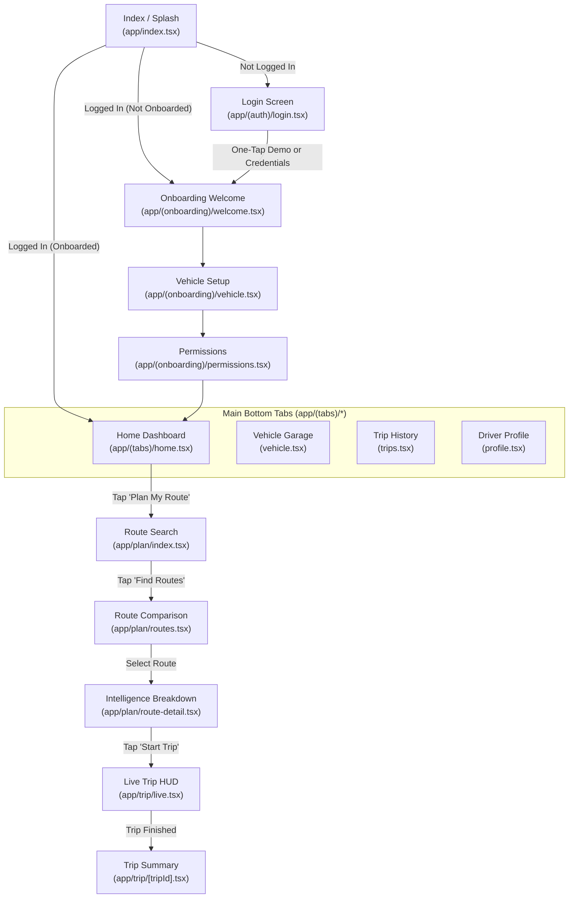

# 📱 04 — Mobile Application Layer (React Native & Expo)

> **Scope:** Detailed engineering guide for `apps/mobile` — Expo Router file navigation, Zustand state stores, screens, UI component library, and backend integration.

---

## 📋 Table of Contents
1. [Mobile Overview & Tech Stack](#1-mobile-overview--tech-stack)
2. [File-Based Navigation Structure (Expo Router)](#2-file-based-navigation-structure-expo-router)
3. [Screen Flow & Navigation Hierarchy](#3-screen-flow--navigation-hierarchy)
4. [Deep Dive into Key Screens](#4-deep-dive-into-key-screens)
   - [Landing & Splash (`app/index.tsx`)](#landing--splash-appindextsx)
   - [Authentication & Demo Login (`app/(auth)/*`)](#authentication--demo-login-appauth)
   - [Onboarding Funnel (`app/(onboarding)/*`)](#onboarding-funnel-apponboarding)
   - [Dashboard & Tabs (`app/(tabs)/*`)](#dashboard--tabs-apptabs)
   - [Route Planning & Comparison (`app/plan/*`)](#route-planning--comparison-appplan)
   - [Live Navigation HUD (`app/trip/live.tsx`)](#live-navigation-hud-apptriplivetsx)
5. [Client State Management (Zustand Stores)](#5-client-state-management-zustand-stores)
6. [UI Components & Design System](#6-ui-components--design-system)
7. [API Client & Network Integration](#7-api-client--network-integration)

---

## 1. Mobile Overview & Tech Stack

The mobile application is a high-performance, cross-platform app that compiles natively to **iOS**, **Android**, and runs seamlessly in any **Web Browser**.

### Core Technologies:
- **Framework:** [React Native](https://reactnative.dev/) (v0.76) + [Expo](https://expo.dev/) (SDK 52)
- **Routing:** [Expo Router v4](https://docs.expo.dev/router/introduction/) (File-system based navigation built on React Navigation)
- **State Management:** [Zustand v5](https://github.com/pmndrs/zustand) (Micro-sized, fast, decoupled global state)
- **Icons:** [`lucide-react-native`](https://lucide.dev/)
- **Theme & Tokens:** Built on `@know-your-route/ui` (consistent tokens for brand colors, spacing, and typography)
- **Server Communication:** `@know-your-route/api-client`

---

## 2. File-Based Navigation Structure (Expo Router)

Expo Router mirrors Next.js: **the folder and file structure inside `apps/mobile/app/` directly determines the app's URLs and navigation routes**.

```text
apps/mobile/app/
├── _layout.tsx              # Root Layout: wraps app with fonts, safe area & status bar
├── index.tsx                # Initial entry screen (Splash & Landing)
│
├── (auth)/                  # Auth Route Group (Hidden from URL path)
│   ├── _layout.tsx          # Stack navigation for Auth screens
│   ├── login.tsx            # Sign in with email or One-Tap Demo button
│   └── signup.tsx           # User registration screen
│
├── (onboarding)/            # Onboarding Funnel Group
│   ├── _layout.tsx          # Onboarding stack layout
│   ├── welcome.tsx          # Step 1: Welcome & Value propositions
│   ├── vehicle.tsx          # Step 2: Register first vehicle & fuel type
│   └── permissions.tsx      # Step 3: Location and Notification permissions
│
├── (tabs)/                  # Main Tab Navigator (Bottom Bar)
│   ├── _layout.tsx          # Bottom tab bar configuration & Lucide icons
│   ├── home.tsx             # Main dashboard (Active vehicle, plan route, alerts)
│   ├── vehicle.tsx          # Vehicle garage, telemetry, snapshot OCR
│   ├── trips.tsx            # Past trip history, distance stats, fuel saved
│   └── profile.tsx          # User profile, driving settings, theme toggle
│
├── plan/                    # Route Intelligence Stack
│   ├── index.tsx            # Origin & Destination search form
│   ├── routes.tsx           # Candidate route comparison cards (Fast, Safe, Eco)
│   └── route-detail.tsx     # Deep intelligence: Safety, Tolls, Weather, Energy
│
└── trip/                    # Active Trip Execution Stack
    ├── live.tsx             # Real-time HUD: Speedometer, alerts, next turn
    └── [tripId].tsx         # Dynamic trip summary & expense receipt
```

---

## 3. Screen Flow & Navigation Hierarchy



---

## 4. Deep Dive into Key Screens

### Landing & Splash (`app/index.tsx`)
- Detects whether the user is already logged in via `useAuthStore`.
- Displays hero branding, animated feature badges (**Safety & Hazard Scores**, **Toll & Energy Estimation**, **Vehicle Telemetry**), and a direct button for **"Get Started"** or **"One-Tap Demo Sign In"**.

---

### Authentication & Demo Login (`app/(auth)/*`)
- **Location:** [`apps/mobile/app/(auth)/login.tsx`](file:///Users/ravichandola/Documents/Know_Your_Route/apps/mobile/app/(auth)/login.tsx)
- Provides standard email/password inputs with client validation.
- Includes a prominent **"One-Tap Demo Sign In"** button that talks to the backend's `/auth/demo-login` endpoint, populates a test user session, and takes you straight into the app in 1 second.

---

### Onboarding Funnel (`app/(onboarding)/*`)
- **Step 1 (`welcome.tsx`):** Explains how predictive route intelligence protects the driver and reduces travel costs.
- **Step 2 (`vehicle.tsx`):** Lets the driver register their car make, model, registration number, and fuel type (`PETROL`, `DIESEL`, `CNG`, or `EV`).
- **Step 3 (`permissions.tsx`):** Explains why background GPS location is needed for real-time hazard warnings and speeds.

---

### Dashboard & Tabs (`app/(tabs)/*`)
- **Home Tab (`home.tsx`):**
  - **Active Vehicle Card:** Shows current car (e.g., *Hyundai Creta SX Petrol*), fuel level percentage bar, and remaining range in km.
  - **"Plan My Route" Primary CTA:** One tap opens the route intelligence search.
  - **Live Corridor Highlights:** Shows real-time warnings (e.g., *"Yamuna Expressway: Light Rain reported at km 45"*).
- **Vehicle Tab (`vehicle.tsx`):**
  - Detailed telemetry stats: tank capacity, odometer, and learned efficiency.
  - "Take Dashboard Photo" button that simulates dashboard OCR snapshot analysis.
- **Trips Tab (`trips.tsx`):**
  - List of past journeys with km driven, money saved on tolls, and fuel consumed.
- **Profile Tab (`profile.tsx`):**
  - Driving preference toggles (Avoid Tolls, Avoid Highways, Rest Stop Interval: default 150 km) and Logout action.

---

### Route Planning & Comparison (`app/plan/*`)
- **Search Form (`plan/index.tsx`):**
  - Origin & Destination pickers with quick presets (e.g., *Delhi ➔ Agra*, *Mumbai ➔ Pune*, *Bengaluru ➔ Mysuru*).
  - Vehicle selector so energy calculations match the exact car you are driving.
- **Comparison Cards (`plan/routes.tsx`):**
  - Renders 3 distinct routes side-by-side:
    1. ⚡ **Fastest Route** (High speed, highway dominant, higher tolls)
    2. 🛡️ **Safest Route** (High safety score, multi-lane divided expressway, low night incident risk)
    3. 🌿 **Eco / Low-Cost Route** (Lower toll fees, optimized fuel burn)
- **Intelligence Detail (`plan/route-detail.tsx`):**
  - **Energy Stat Box:** Shows exact Litres or kWh required, estimated cost in ₹, and whether current tank is sufficient.
  - **FASTag Stat Box:** Shows total toll plaza cost, current FASTag balance, and shortfall alert if balance is too low.
  - **Safety Score Bar:** Displays score (e.g., 91/100) and lists any caution zones.
  - **Corridor Weather:** Shows temperature, wind speed, and precipitation forecast along the road.

---

### Live Navigation HUD (`app/trip/live.tsx`)
Designed specifically for in-car dashboard mounting:
- **Large Digital Speedometer:** High-contrast speed readout.
- **Speed Limit Warning:** Highlights speed in red if exceeding highway limits.
- **Corridor Advisory Bar:** Dynamic notices (e.g., *"Next Toll Plaza in 12 km - ₹135 FASTag auto-debit"*).
- **Next Turn Guidance:** Next waypoint distance and maneuver icon.

---

## 5. Client State Management (Zustand Stores)

All global state is stored in lightweight Zustand stores inside `apps/mobile/src/stores/`:

### 1. `auth.store.ts`
Manages the user authentication lifecycle:
```typescript
interface AuthState {
  user: User | null;
  token: string | null;
  isAuthenticated: boolean;
  login: (credentials: LoginRequest) => Promise<void>;
  demoLogin: () => Promise<void>;
  logout: () => void;
  setOnboarded: (status: boolean) => void;
}
```

### 2. `vehicle.store.ts`
Manages vehicles and active car selection:
```typescript
interface VehicleState {
  vehicles: VehicleProfile[];
  activeVehicle: VehicleProfile | null;
  setActiveVehicle: (vehicle: VehicleProfile) => void;
  fetchVehicles: () => Promise<void>;
  addVehicle: (vehicleData: Partial<VehicleProfile>) => Promise<void>;
}
```

### 3. `route.store.ts`
Manages the active trip search and candidate routes:
```typescript
interface RouteState {
  origin: Waypoint | null;
  destination: Waypoint | null;
  candidateRoutes: RouteProfile[];
  selectedRoute: RouteProfile | null;
  setOrigin: (origin: Waypoint) => void;
  setDestination: (destination: Waypoint) => void;
  setSelectedRoute: (route: RouteProfile) => void;
}
```

---

## 6. UI Components & Design System

Re-usable UI components live in [`apps/mobile/src/components/`](file:///Users/ravichandola/Documents/Know_Your_Route/apps/mobile/src/components):

| Component | Description |
| :--- | :--- |
| `Button` | High-impact action button supporting `primary`, `secondary`, `outline`, and `danger` variants, plus loading spinners and icon prefixes. |
| `Card` | Sleek container with rounded corners (`radius.lg = 16px`), slate border, and subtle elevation shadow. |
| `Input` | Text input field with floating label, clear button, and error message rendering. |
| `DevBadge` | Pill badge that indicates whether the app is connected to `MOCK` or `LIVE` backend services. |
| `StatBox` | Clean metric card displaying label, primary value (e.g. `240 km`), and secondary badge (e.g. `₹420 Toll`). |

---

## 7. API Client & Network Integration

The mobile app accesses the backend via [`apps/mobile/src/api/client.ts`](file:///Users/ravichandola/Documents/Know_Your_Route/apps/mobile/src/api/client.ts):

```typescript
import { BaseApiClient } from '@know-your-route/api-client';
import { ENV } from '../config/env';
import { useAuthStore } from '../stores/auth.store';

export const apiClient = new BaseApiClient({
  baseUrl: ENV.API_BASE_URL,
  getAuthToken: () => useAuthStore.getState().token,
  timeoutMs: 12000,
  onUnauthorized: () => {
    // If JWT expires, log user out and redirect to login automatically
    useAuthStore.getState().logout();
  },
});
```

Whenever any screen calls `apiClient.get('/vehicles')` or `apiClient.post('/routes/plan', data)`:
1. The current JWT token from `useAuthStore` is automatically attached as an `Authorization: Bearer <token>` header.
2. If the request times out (>12s) or the server returns an error, the error is normalized into a user-friendly message.
3. If a 401 Unauthorized status is received, the app safely returns the user to the login screen without crashing.

---

👉 **Next Step:** To understand the shared packages that connect the mobile app and backend, read [**05-SHARED-PACKAGES-LAYER.md**](./05-SHARED-PACKAGES-LAYER.md).
