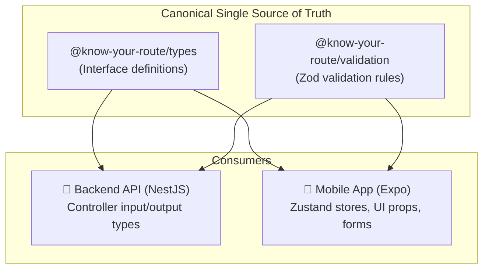

# 📦 05 — Shared Packages Layer

> **Scope:** Detailed engineering guide for `packages/*` — Domain contracts (`types`), runtime schemas (`validation`), HTTP transport (`api-client`), design tokens (`ui`), and build tools (`config`).

---

## 📋 Table of Contents
1. [The "Shared Code" Philosophy](#1-the-shared-code-philosophy)
2. [Package Inventory](#2-package-inventory)
3. [`@know-your-route/types` (Canonical Domain Contracts)](#3-know-your-routetypes-canonical-domain-contracts)
4. [`@know-your-route/validation` (Zod Runtime Schemas)](#4-know-your-routevalidation-zod-runtime-schemas)
5. [`@know-your-route/api-client` (Resilient HTTP Transport)](#5-know-your-routeapi-client-resilient-http-transport)
6. [`@know-your-route/ui` (Design Tokens & Theming)](#6-know-your-routeui-design-tokens--theming)
7. [`@know-your-route/config` (Centralized Build Standards)](#7-know-your-routeconfig-centralized-build-standards)
8. [How Workspace Linking Works in `pnpm`](#8-how-workspace-linking-works-in-pnpm)

---

## 1. The "Shared Code" Philosophy

In traditional multi-repo setups, the frontend and backend maintain separate duplicate TypeScript definitions. Over time, these drift apart: the backend renames a field (e.g. `distance` to `distanceKm`), and the frontend crashes with `undefined` errors.

**In Know Your Route, this failure mode is impossible.**  
Both the mobile app (`apps/mobile`) and the backend API (`apps/api`) consume the exact same packages from `packages/`. If an API developer changes a field in `@know-your-route/types`, TypeScript immediately flags all affected frontend screens before code is even committed.



---

## 2. Package Inventory

```text
packages/
├── types/          # Shared Canonical Domain Contracts
│   └── src/        # user, vehicle, route, energy, fastag, safety, weather, trip, ai
├── validation/     # Shared Zod Schemas
│   └── src/        # auth.schema, vehicle.schema, route.schema, trip.schema
├── api-client/     # Resilient HTTP Client Gateway
│   └── src/        # BaseApiClient, ApiError, auth injection, timeouts
├── ui/             # Design Tokens & Theme system
│   └── src/        # colors, spacing, typography, radius, shadows
└── config/         # Shared configs
    └── tsconfig/   # tsconfig.base.json, tsconfig.node.json
```

---

## 3. `@know-your-route/types` (Canonical Domain Contracts)

Located at [`packages/types/`](file:///Users/ravichandola/Documents/Know_Your_Route/packages/types/).  
This package contains zero runtime overhead (pure TypeScript interfaces and enums):

### Key Exported Contracts:

#### 1. Vehicle Profile (`vehicle.ts`)
```typescript
export type FuelType = 'PETROL' | 'DIESEL' | 'CNG' | 'EV';

export interface VehicleProfile {
  id: string;
  userId: string;
  make: string;
  model: string;
  variant?: string;
  year?: number;
  registrationNumber: string;
  fuelType: FuelType;
  tankCapacity?: number;       // Litres or kWh
  currentState?: {
    fuelLevel?: number;        // Percentage 0-100
    batteryLevel?: number;     // Percentage 0-100
    odometer?: number;         // Total km
    rangeKm?: number;          // Estimated remaining km
  };
  efficiency?: {
    estimated: number;         // km/L or km/kWh (from OEM specs)
    learned?: number;          // km/L calibrated from actual trips
  };
}
```

#### 2. Route Profile & Contexts (`route.ts`)
```typescript
export interface RouteProfile {
  id: string;
  name: string;
  summary: string;
  distanceKm: number;
  durationMinutes: number;
  traffic: TrafficContext;
  toll: TollContext;
  energy: EnergyContext;
  safety: SafetyContext;
  weather: WeatherContext;
  fastag?: FastagContext;
  usefulStops: UsefulStop[];
  geometryJson?: unknown;
}
```

#### 3. Energy Context (`energy.ts`)
```typescript
export interface EnergyContext {
  fuelType: FuelType;
  estimatedConsumption: number; // e.g. 18.5 Litres or 34 kWh
  consumptionUnit: 'LITRES' | 'KWH';
  estimatedCost: number;        // in INR ₹
  currency: 'INR';
  sufficientInitialLevel: boolean;
  requiredRefuelCount: number;
  recommendedRefuelDistanceKm?: number;
}
```

#### 4. Safety Context (`safety.ts`)
```typescript
export interface SafetyContext {
  overallScore: number;         // 0 - 100
  rating: 'HIGH' | 'MODERATE' | 'CAUTION';
  nightDrivingRisk: 'LOW' | 'MEDIUM' | 'HIGH';
  knownIncidents: IncidentHazard[];
  emergencyServicesNearbyCount: number;
  summary: string;
}
```

---

## 4. `@know-your-route/validation` (Zod Runtime Schemas)

Located at [`packages/validation/`](file:///Users/ravichandola/Documents/Know_Your_Route/packages/validation/).  
While TypeScript types exist only during development, **Zod schemas validate data at runtime**.

### Schema Examples:

```typescript
// vehicle.schema.ts
import { z } from 'zod';

export const CreateVehicleSchema = z.object({
  make: z.string().min(1, 'Make is required'),
  model: z.string().min(1, 'Model is required'),
  registrationNumber: z
    .string()
    .regex(/^[A-Z]{2}[0-9]{1,2}[A-Z]{1,3}[0-9]{4}$/, 'Invalid Indian vehicle registration plate'),
  fuelType: z.enum(['PETROL', 'DIESEL', 'CNG', 'EV']),
  tankCapacity: z.number().positive().optional(),
  odometer: z.number().nonnegative().optional(),
});

export type CreateVehicleDto = z.infer<typeof CreateVehicleSchema>;
```

### Where is it used?
1. **In the Mobile App:** When the user enters a registration plate (e.g. `DL01AB1234`), the form runs `CreateVehicleSchema.safeParse(data)` before sending an HTTP request, immediately highlighting invalid inputs.
2. **In the Backend API:** The NestJS controller executes the exact same schema. Even if someone sends a curl request with malicious data, it is rejected before touching the database.

---

## 5. `@know-your-route/api-client` (Resilient HTTP Transport)

Located at [`packages/api-client/`](file:///Users/ravichandola/Documents/Know_Your_Route/packages/api-client/).  
A lightweight, dependency-free wrapper around the native `fetch` API.

### Features:
- **Automatic JWT Bearer Token Injection:** Extracts the active token dynamically for every outgoing request.
- **Configurable Timeout:** Automatically aborts hanging requests using `AbortController` (default: 15 seconds).
- **Error Normalization:** Converts network disconnects, HTTP 400 validation errors, and HTTP 500 server crashes into a clean `ApiError` class.
- **Unauthorized Interceptor (`onUnauthorized`):** Automatically triggers when receiving HTTP 401, enabling seamless session expiration without manual checks on every screen.

```typescript
export class BaseApiClient {
  async request<T>(endpoint: string, options: RequestInit = {}): Promise<T> {
    // 1. Attach Base URL
    // 2. Attach Authorization: Bearer <token>
    // 3. Set AbortController timeout
    // 4. Execute fetch
    // 5. Check response status & parse JSON
    // 6. Normalize error if !res.ok
  }

  get<T>(endpoint: string) { return this.request<T>(endpoint, { method: 'GET' }); }
  post<T>(endpoint: string, data?: unknown) { ... }
  put<T>(endpoint: string, data?: unknown) { ... }
  delete<T>(endpoint: string) { ... }
}
```

---

## 6. `@know-your-route/ui` (Design Tokens & Theming)

Located at [`packages/ui/`](file:///Users/ravichandola/Documents/Know_Your_Route/packages/ui/).  
Defines the visual design language used throughout the mobile app.

### 1. Colors (`tokens.ts`)
```typescript
export const colors = {
  // Brand Blues
  brand: {
    500: '#3B82F6',
    600: '#2563EB',
    900: '#1E3A8A',
  },
  // Accents
  emerald: { 500: '#10B981' },
  cyan: { 500: '#06B6D4' },
  
  // Neutrals (Dark mode friendly Slate)
  slate: {
    50: '#F8FAFC',
    800: '#1E293B',
    900: '#0F172A',
    950: '#020617',
  },

  // Traffic Conditions
  traffic: {
    light: '#10B981',      // Green
    moderate: '#F59E0B',   // Amber
    heavy: '#EF4444',      // Red
    congested: '#991B1B',  // Dark Crimson
  },

  // Fuel Categories
  fuel: {
    petrol: '#F97316',     // Orange
    diesel: '#3B82F6',     // Blue
    cng: '#10B981',        // Green
    ev: '#06B6D4',         // Cyan
  },
};
```

### 2. Spacing, Radius, Typography & Shadows
- **Spacing:** Multiples of 4 (`xs: 4`, `sm: 8`, `md: 12`, `lg: 16`, `xl: 20`, `xxl: 24`, `3xl: 32`).
- **Radius:** `sm: 8`, `md: 12`, `lg: 16`, `full: 9999`.
- **Shadows:** Native mobile shadows (`shadowOffset`, `shadowOpacity`, `elevation` for Android).

---

## 7. `@know-your-route/config` (Centralized Build Standards)

Located at [`packages/config/`](file:///Users/ravichandola/Documents/Know_Your_Route/packages/config/).  
Ensures all projects within the monorepo compile with strict TypeScript settings:
- Strict null checks enabled
- No unused locals or parameters
- Consistent module resolution (`bundler` mode)

---

## 8. How Workspace Linking Works in `pnpm`

Inside `apps/mobile/package.json` and `apps/api/package.json`, notice how shared packages are declared:

```json
{
  "dependencies": {
    "@know-your-route/types": "workspace:*",
    "@know-your-route/validation": "workspace:*",
    "@know-your-route/api-client": "workspace:*",
    "@know-your-route/ui": "workspace:*"
  }
}
```

The `"workspace:*"` protocol tells `pnpm` to symlink directly to local folders inside `packages/` rather than searching on npm. This means:
- **Instant updates:** Editing code inside `packages/types/src/` is immediately available in `apps/mobile` and `apps/api` without building or reinstalling!

---

👉 **Next Step:** To see how the backend intelligence algorithms and provider adapters work, read [**06-PROVIDERS-AND-INTELLIGENCE.md**](./06-PROVIDERS-AND-INTELLIGENCE.md).
