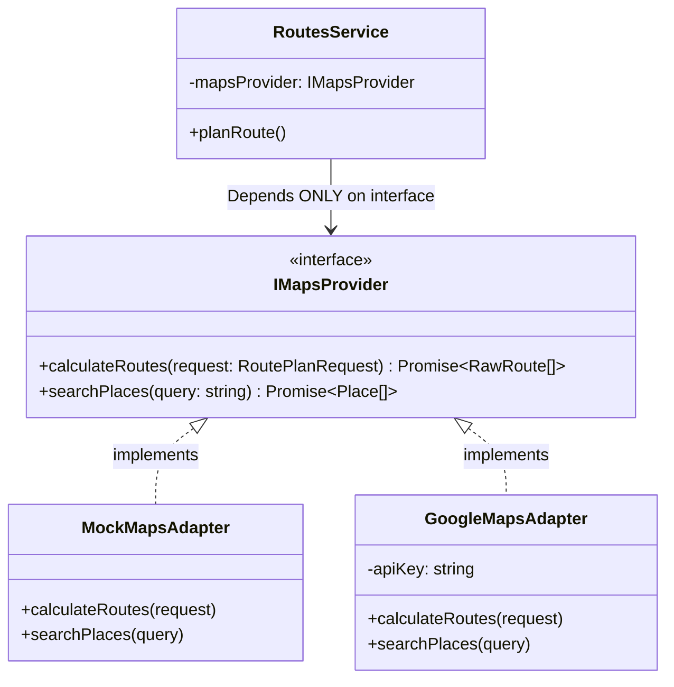

# 🧠 06 — Providers & Intelligence Engines

> **Scope:** Detailed engineering guide for the Strategy Pattern Provider Adapters (`Mock` vs `Real`) and the Domain Intelligence Engines (Energy, Safety, FASTag, AI Rationale).

---

## 📋 Table of Contents
1. [The Strategy Pattern Architecture](#1-the-strategy-pattern-architecture)
2. [Provider Interfaces & Factory Switching](#2-provider-interfaces--factory-switching)
3. [Provider Breakdown](#3-provider-breakdown)
   - [Maps Provider (Google Maps vs Mock)](#maps-provider)
   - [Weather Provider (OpenWeather vs Mock)](#weather-provider)
   - [Toll & FASTag Provider (NETC / NHAI vs Mock)](#toll--fastag-provider)
   - [Vehicle Telemetry & Snapshot OCR Provider](#vehicle-telemetry--snapshot-ocr-provider)
   - [AI Rationale Provider (OpenAI / Gemini vs Mock)](#ai-rationale-provider)
4. [Energy & Fuel Intelligence Engine](#4-energy--fuel-intelligence-engine)
5. [Predictive Road Safety Engine](#5-predictive-road-safety-engine)
6. [FASTag Toll Sufficiency Engine](#6-fastag-toll-sufficiency-engine)
7. [How to Switch to Real Production APIs](#7-how-to-switch-to-real-production-apis)

---

## 1. The Strategy Pattern Architecture

In enterprise software, binding core business logic directly to a specific third-party library (like Google Maps SDK or OpenAI SDK) creates vendor lock-in.

In **Know Your Route**, every external service is abstracted behind a TypeScript interface. The business logic (`RoutesService`, `EnergyService`, `FastagService`) only interacts with the interface—it does not care whether the data is coming from a live Google satellite feed or an ultra-fast local mock adapter.



---

## 2. Provider Interfaces & Factory Switching

Inside [`apps/api/src/providers/providers.module.ts`](file:///Users/ravichandola/Documents/Know_Your_Route/apps/api/src/providers/providers.module.ts), NestJS dynamic providers use the `useFactory` pattern to instantiate the correct adapter based on your environment variables:

```typescript
// providers.module.ts
{
  provide: MAPS_PROVIDER,
  useFactory: (configService: ConfigService) => {
    const mode = configService.get<string>('MAP_PROVIDER', 'mock');
    if (mode === 'real') {
      const apiKey = configService.get<string>('GOOGLE_MAPS_API_KEY');
      return new GoogleMapsAdapter(apiKey);
    }
    return new MockMapsAdapter(); // Zero-cost instant local development
  },
  inject: [ConfigService],
}
```

### Benefits:
- **Instant local startup:** New developers don't need billing accounts or credit cards to start building.
- **Zero test fees:** Automated integration tests run with mock adapters in milliseconds for ₹0 cost.
- **Zero code changes for production:** Deploying to production only requires setting `MAP_PROVIDER=real` in your cloud environment.

---

## 3. Provider Breakdown

### Maps Provider
- **Interface:** `IMapsProvider` in `apps/api/src/providers/maps/maps.interface.ts`
- **Adapters:** `MockMapsAdapter` / `GoogleMapsAdapter`
- **Responsibility:**
  - Calculates driving routes between Origin and Destination.
  - Generates realistic polyline waypoints along corridors (e.g., *Delhi ➔ Agra via Yamuna Expressway*).
  - Supplies road metadata (highway vs city street breakdown percentage).

---

### Weather Provider
- **Interface:** `IWeatherProvider` in `apps/api/src/providers/weather/weather.interface.ts`
- **Adapters:** `MockWeatherAdapter` / `OpenWeatherAdapter`
- **Responsibility:**
  - Retrieves real-time weather along the entire travel corridor rather than just the destination.
  - Reports temperature, precipitation probability, crosswind speeds, and fog/visibility warnings.

---

### Toll & FASTag Provider
- **Interface:** `ITollProvider` & `IFastagProvider` in `apps/api/src/providers/toll/` and `apps/api/src/providers/fastag/`
- **Responsibility:**
  - Maps toll gates along the selected highway.
  - Returns NHAI-compliant toll rates for passenger cars.
  - Queries simulated or live NETC FASTag wallet balances.

---

### Vehicle Telemetry & Snapshot OCR Provider
- **Interface:** `IVehicleProvider` in `apps/api/src/providers/vehicle/`
- **Responsibility:**
  - Analyzes dashboard images submitted by drivers.
  - Simulates computer vision / OCR to detect analog odometer numbers, fuel needle angles, and EV battery percentage indicators.

---

### AI Rationale Provider
- **Interface:** `IAIProvider` in `apps/api/src/ai/`
- **Adapters:** `MockAiAdapter` / `OpenAiAdapter` / `GeminiAdapter`
- **Responsibility:**
  - Synthesizes complex multi-dimensional route data into clear, human-friendly guidance.
  - Explains the trade-offs between speed, cost, and safety.

---

## 4. Energy & Fuel Intelligence Engine

Located in [`apps/api/src/energy/energy.service.ts`](file:///Users/ravichandola/Documents/Know_Your_Route/apps/api/src/energy/energy.service.ts).

### The Math & Physics Formula:

$$\text{Estimated Consumption} = \frac{\text{Distance in km}}{\text{Vehicle Efficiency (km/L or km/kWh)}}$$

```typescript
// Simplified excerpt from energy.service.ts
const isEv = vehicle.fuelType === 'EV';

// 1. Determine vehicle efficiency (prefer learned data over OEM claims)
const baseEfficiency =
  vehicle.efficiency?.learned ??
  vehicle.efficiency?.estimated ??
  (isEv ? 7.2 : 14.5); // Default: 7.2 km/kWh for EV, 14.5 km/L for Petrol

// 2. Calculate consumption
const consumption = Number((distanceKm / baseEfficiency).toFixed(1));

// 3. Calculate trip cost in INR ₹
const pricePerUnit = isEv ? 18 : vehicle.fuelType === 'DIESEL' ? 92 : 105;
const estimatedCost = Math.round(consumption * pricePerUnit);

// 4. Determine if current tank/battery is sufficient
const availableEnergy = (currentLevel / 100) * tankCapacity;
const sufficientInitialLevel = availableEnergy >= consumption;

// 5. Predict needed refuel stops
const remainingRange = vehicle.currentState?.rangeKm ?? Math.round(availableEnergy * baseEfficiency);
const requiredRefuelCount = remainingRange < distanceKm 
  ? Math.ceil((distanceKm - remainingRange) / (tankCapacity * baseEfficiency * 0.8)) 
  : 0;
```

---

## 5. Predictive Road Safety Engine

Located in [`apps/api/src/safety/safety.service.ts`](file:///Users/ravichandola/Documents/Know_Your_Route/apps/api/src/safety/safety.service.ts).

### How Safety is Evaluated:
1. **Infrastructure Factor:** Highways with continuous median physical dividers score significantly higher than undivided 2-lane state highways.
2. **Night Driving Risk:** 
   - Multi-lane access-controlled expressways (like Yamuna or Mumbai-Pune Expressway) have high illumination and dedicated patrol vehicles (`LOW` night risk).
   - Rural bypasses with mixed traffic, animal crossings, and no median barriers are flagged with `MEDIUM` or `HIGH` night risk.
3. **Known Hazard Incidents:** Simulates blackspot warnings (e.g., *"Poor street lighting at km 42"*, *"Frequent crosswinds on bridge section"*).
4. **Emergency Services Proximity:** Measures density of trauma centers and highway ambulance posts within a 10 km radius.

---

## 6. FASTag Toll Sufficiency Engine

Located in [`apps/api/src/fastag/fastag.service.ts`](file:///Users/ravichandola/Documents/Know_Your_Route/apps/api/src/fastag/fastag.service.ts).

### The Problem:
Drivers often enter an expressway only to find their FASTag blacklisted or lacking sufficient funds at the second or third toll plaza, causing heavy delays and double-cash penalties.

### The Solution:
```typescript
async verifyTollSufficiency(tagNumber: string, expectedTollCost: number): Promise<FastagContext> {
  const status = await this.fastagProvider.getFastagStatus(tagNumber);
  
  const isSufficient = status.currentBalance >= expectedTollCost;
  const shortfall = isSufficient ? 0 : expectedTollCost - status.currentBalance;

  return {
    ...status,
    isBalanceSufficientForTrip: isSufficient,
    shortfallAmount: shortfall > 0 ? shortfall : undefined,
    lowBalanceWarning: status.currentBalance < 200 || !isSufficient,
  };
}
```

The driver receives a clear badge on the route comparison screen:  
`⚠️ Shortfall: ₹140. Please recharge your FASTag before departing.`

---

## 7. How to Switch to Real Production APIs

When you are ready to connect live credentials, update `.env.development` or your production deployment environment:

```bash
# 1. Enable Real Maps
MAP_PROVIDER=real
GOOGLE_MAPS_API_KEY=AIzaSyD-YourRealGoogleMapsKeyHere

# 2. Enable Real Weather
WEATHER_PROVIDER=real
OPENWEATHER_API_KEY=your_openweather_api_key_here

# 3. Enable Real AI Rationale
AI_PROVIDER=real
OPENAI_API_KEY=sk-proj-YourOpenAiKeyHere
# or
GEMINI_API_KEY=AIzaSy-YourGeminiKeyHere
```

Restart the backend server (`pnpm dev:api`). NestJS will automatically boot the production adapters!

---

👉 **Next Step:** To learn how to build, test, and deploy the entire project, read [**07-DEVELOPMENT-AND-DEPLOYMENT.md**](./07-DEVELOPMENT-AND-DEPLOYMENT.md).
