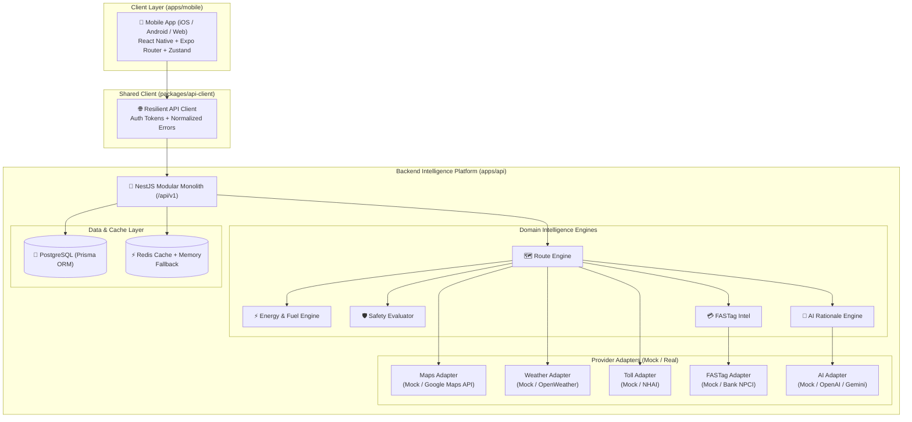

# 📚 Know Your Route — Complete Documentation

> **Intelligent Route, Vehicle & Trip Safety Platform**  
> A high-performance, cross-platform mobile app (React Native + Expo) powered by a modular intelligence backend (NestJS + Prisma + Redis).

Welcome to the **Know Your Route** developer and architecture documentation! Whether you are a senior engineer, an open-source contributor, or someone setting up this project for the very first time with **zero prior knowledge**, this documentation is designed to guide you step-by-step.

---

## 🗺️ Documentation Index

| Chapter | Document | What You Will Learn |
| :--- | :--- | :--- |
| **01** | [**Getting Started & Beginner Setup**](./01-GETTING-STARTED.md) | Absolute beginner guide: tools to install, step-by-step setup, running on Web, Android, iOS, or phone via Expo Go, environment variables, and troubleshooting. |
| **02** | [**System Architecture & Data Flow**](./02-SYSTEM-ARCHITECTURE.md) | High-level topology, monorepo mechanics (Turborepo + pnpm), client-server philosophy, and end-to-end request/response lifecycles with diagrams. |
| **03** | [**Backend API Layer (NestJS)**](./03-BACKEND-API-LAYER.md) | Deep dive into `apps/api`: modules, controllers, services, database models (Prisma), caching (Redis + In-Memory fallback), and Swagger docs. |
| **04** | [**Mobile Application Layer (React Native / Expo)**](./04-MOBILE-APP-LAYER.md) | Deep dive into `apps/mobile`: Expo Router file navigation, Zustand state stores, screens (Auth, Onboarding, Route Planning, Live HUD), and UI components. |
| **05** | [**Shared Packages Layer**](./05-SHARED-PACKAGES-LAYER.md) | Shared monorepo packages (`types`, `validation`, `api-client`, `ui`, `config`): why they exist and how code is reused cleanly across client and server. |
| **06** | [**Providers & Intelligence Engines**](./06-PROVIDERS-AND-INTELLIGENCE.md) | Provider strategy pattern (Mock vs Real: Maps, Weather, Toll, FASTag, AI), Energy calculation math, Safety scoring algorithms, and toll sufficiency logic. |
| **07** | [**Development & Deployment Guide**](./07-DEVELOPMENT-AND-DEPLOYMENT.md) | Day-to-day workflow, Turbo scripts, adding a new feature end-to-end (code examples), Docker & Cloud deployment, and EAS Mobile builds. |

---

## ⚡ What is "Know Your Route"?

Most navigation apps (like Google Maps or Apple Maps) only tell you:
1. Turn left / Turn right
2. Estimated time of arrival (ETA)

**Know Your Route does what standard GPS apps cannot:**
- 🔋 **Energy & Fuel Intelligence:** Predicts exact fuel (Litres) or EV charge (kWh) needed for the specific vehicle profile (Hyundai Creta, Tata Nexon EV, etc.), tells you if your current tank/battery is enough, and calculates total fuel expense in ₹ INR.
- 🛡️ **Predictive Safety Score:** Evaluates highway dividers, lighting, accident-prone zones, and night driving risk to assign an objective safety score (0–100).
- 💳 **FASTag & Toll Sufficiency:** Scans all toll plazas along candidate routes, calculates total toll amount, checks your live FASTag balance, and warns of any shortfall before you reach the toll gate.
- 🌦️ **Corridor Weather:** Aggregates real-time weather across every segment of your route (rain, fog, crosswinds) rather than just destination weather.
- 🤖 **AI Route Rationale:** Provides clear, human-understandable advice on why one route is recommended over alternatives (e.g., *"Take Eastern Bypass: saves ₹140 on tolls and avoids heavy rain in Sector 18"*).

---

## 🏛️ System Architecture at a Glance



---

## 🚀 Quick Start Command Cheat Sheet

```bash
# 1. Install all dependencies across the entire monorepo
pnpm install

# 2. Run both Backend API and Mobile App together
pnpm dev

# 3. Run Backend API only (runs on port 4000)
pnpm dev:api

# 4. Run Mobile App only (Expo Metro bundler on port 8081)
pnpm dev:mobile

# 5. Typecheck all packages and apps
pnpm typecheck

# 6. Format all code
pnpm format
```

👉 **Ready to run the project?** Head over to [**01-GETTING-STARTED.md**](./01-GETTING-STARTED.md) for the complete, step-by-step setup guide for beginners!
